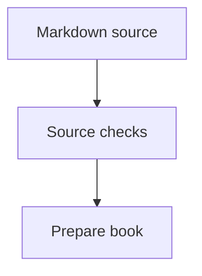
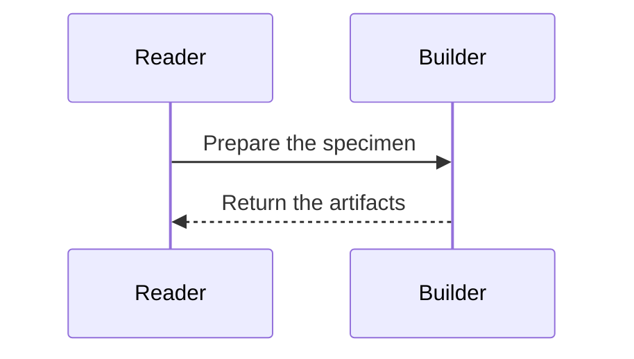

# Format a chapter across outputs

How can notes, wider material, and notation help the reader while preserving
one reading order? The accepted first rendering draft uses Markdown source for
responsive HTML, reflowable EPUB 3, a double-sided book PDF, and a one-sided A4
PDF. This reference describes the forms supported by that draft. The
[rendering guide](../../../../docs/project/rendering.md) owns tool versions,
page geometry, build commands, and replacement conditions.

Keep the explanation connected in the main text. A reader must be able to
follow its reasoning when notes move, columns collapse, or figures scale.
Use formatting to expose a relationship or make secondary material available
near its reference. A required definition, causal step, diagnostic, or exercise
instruction belongs in the main reading path.

## Choose the element

| Element | Use it for |
| --- | --- |
| Ordinary paragraph | The argument and what the reader must do or understand |
| Numbered sidenote | Optional detail or credit attached to particular words |
| Unnumbered margin note | A brief reminder with a clear local association |
| Full-width aside or figure | Content whose structure needs wider space |
| Diagram | A relationship whose structure helps explain the idea |
| Page break | A verified print grouping that needs a fresh page |

Choose the relationship before considering the length. A long clarification
can remain a numbered sidenote; a short reminder may need no number. A
full-width region can hold a diagram, illustration, table, derivation, or other
content that needs the space. A wide figure may be part of the central
explanation; its width does not make it optional material.

These are ash-doc authoring conventions, informed by
[Tufte's discussion of notes][tufte-notes], particularly his comments of
September 13, 2003 and September 4, 2006. He argues for worthwhile marginal
material and content-driven annotation while keeping important discussion in
the main text. The three-form distinction here is our own adaptation of those
principles. Leave margins empty when there is no useful annotation; do not
create a parallel commentary merely to fill the layout.

The governing test is whether the note helps the reader understand the nearby
text without creating a competing reading task. Give it one clear point and
familiar vocabulary. A sketch should reveal a relationship with little effort,
and a clarification should resolve a plausible local uncertainty. Remove a
note that merely repeats the paragraph, sends the reader on an unrelated
detour, or takes more effort to interpret than the help it provides. Several
notes beside one passage may need combining or cutting, even when they fit.
Let the main account set the pace.

Use standard emphasis, inline code, lists, and tables within these forms.
Keep runnable Ash blocks connected to canonical source and checks as required
by the writing skill. Preserve complete diagnostics and program text; change
their presentation rather than abbreviating them to fit a page.

## Numbered sidenotes

Use a numbered sidenote when a reader needs to identify the exact sentence,
phrase, or claim that optional material supports. Suitable uses include source
credit, a qualification of one claim, an alternate interpretation, or a
supporting detail that would interrupt its paragraph. Place the reference at
that point. Required definitions, reasoning, corrections, and observations
remain in the main explanation.

Use Markdown footnote references and definitions. Short and longer notes use
the same source form:

```markdown
The main explanation stays in this paragraph.[^clarification]

[^clarification]: A short secondary clarification.

Continue the reasoning in the main text.[^detail]

[^detail]: A longer clarification can contain several sentences. Keep it
    secondary to the argument and indent continued lines by four spaces.
    The sentence with its reference should still make sense on its own.
```

Choose descriptive note identifiers and place each reference beside the words
it explains. The renderer supplies the visible numbers. Keep the definition
near the referring paragraph in source so an author can review them together.

Desktop HTML places notes on the right. The book PDF uses the outer margin,
alternating sides for double-sided printing. A4 keeps both short and longer
notes in its wider right margin. Narrow HTML moves notes into the reading
flow; EPUB uses linked notes with a return path. Do not author different note
text or manually position it for each output.

A longer secondary explanation can remain a sidenote. Check that it fits with
nearby notes in both PDFs at readable type size. If it crowds or overlaps them,
shorten the secondary material or develop the needed explanation in the main
text. Do not shrink the note's type to force it into the margin. Notes must not
disclose an observation that an exercise asks the reader to discover.
Keep notes flat: another clarification belongs in the same note, a separate
note, or the main text. Nested notes do not survive the current Markdown
preparation reliably.

## Unnumbered margin notes

Use an unnumbered margin note for a brief reading cue, reminder of an already
introduced idea, or secondary observation about a nearby example. Its local
context should make the association clear. Begin with a meaningful label such
as *Recall* or *Reading cue* when that helps identify its purpose. If the
reader must track particular words to understand the association, use a
numbered sidenote.

Use a fenced Div with `.column-margin`, in source order beside its context:

```markdown
The next example uses the notation introduced above.

::: {#note-reading-cue .column-margin}
*Reading cue.* Read the premises before the conclusion.
:::

Continue the explanation in the main text.
```

The renderer places it in the right margin of desktop HTML and A4, and in the
alternating outer margin of the book PDF. It has no reference number. Narrow
HTML and EPUB include its labelled text in ordinary reading order, so place
it where that order remains sensible. Do not rely on a phrase such as “see the
note on the right” to identify it. Keep it brief enough for the reader to
recognise its purpose; a sustained secondary argument belongs in prose or a
self-contained aside.

### Diagrams and sketches in notes

Both numbered sidenotes and unnumbered margin notes can offer a small diagram
or sketch that reinforces intuition. A commutative diagram may make a
relationship visible; a schematic program-state snapshot or call-stack sketch
may reinforce a trace already explained in the main text. Use a numbered note
when the sketch supports particular words or a particular step, and an
unnumbered note when the labelled local association is sufficient.

The text must supply the definitions, causal reasoning, and observations the
reader needs. A supplementary drawing can provide another view of that account.
Make clear what its labels represent, such as a source-level calculation or a
schematic state, and use terms the chapter has already introduced. The sketch
must remain faithful to the example even though it is optional.

Check it at the actual note-column width in both PDFs and on a narrow screen.
Keep one visual point, short labels, and enough space to follow arrows or
distinguish state entries. Aim for the same label legibility used for other
figures below. A reduced copy of a dense full-width diagram will often be
unreadable; redraw a smaller relevant portion, use a prose reminder, or move a
useful larger figure into the main or full-width reading area.
Use restrained styling consistent with the secondary text. Contrast should
make the relationships readable without giving the sketch undue prominence.

Give an image a meaningful alternative description and a brief explanatory
label or caption. Keep a prepared static SVG in `assets/` beside the lesson's
README and use its relative path. Set `fig-alt` explicitly; Quarto treats the
bracketed image text as its caption. Keep the image in its own paragraph, with
blank lines separating nearby comments, so native figure handling retains that
caption:

```markdown
{fig-alt="Outer calls inner." width=100%}
```

Preparation copies used images from within the lesson directory, including
images in notes and Divs, while preserving their attributes. These SVGs must
have an explicit viewport and outlined labels, with no scripts, HTML elements,
or external resources. Other source-image formats remain outside this checked
preparation boundary. The [search-tree lesson][tree-lesson] supplies a graphical
sidenote, an unnumbered counting cue, and a full-width repair comparison.

The image must work in grayscale and when its note returns to EPUB reading
order. In browser review, let fonts, images, and native margin positioning
settle before checking nearby notes for overlap. Prefer viewport captures and
check note bounds again after capture; the [QA report][tool-report] records a
full-page capture limitation. Prepared static images can occupy the note
layout. Raw diagram fences inside notes or margin Divs remain outside the
current adapter contract;
the authoring purpose does not make those fences automatically convertible.

## Full-width material

Use full-width space when a comparison, diagram, illustration, derivation, or
other content needs the main column and adjoining note area. Introduce a
self-contained aside at a natural turn in the explanation and give it a
descriptive opening. Figures retain their captions and their connection to the
surrounding account. The wider region must have a content reason; it is not
overflow storage for a crowded sidenote.

Use a fenced Div with `.column-page-right`. This paragraph-and-table example
shows its source form; the same layout can hold a prepared image. Give the
region a descriptive identifier:

```markdown


::: {#notation-comparison .column-page-right}
*Reading the notation.* The wider area keeps the comparison together.

| Notation | Relationship | Reading order |
| --- | --- | --- |
| Inference rule | Premises support a conclusion | Premises, then conclusion |
| Interaction sequence | Participants exchange messages | Follow message order |

:::
```

The block is part of the chapter's reading order. It is an unnumbered aside or
figure region, separate from a referenced sidenote. It spans the body and outer
note area in the book PDF, and the body and right note area in A4 and desktop
HTML. Binding space and HTML navigation stay outside it. Narrow HTML and EPUB
return it to their available reading width, so use content that can wrap.

Keep a wide block short enough for one page in both PDFs. The current print
implementation does not reliably handle wide blocks across mirrored page
breaks. Check that the complete paragraph and table stay together and do not
intersect sidenotes. If the material is longer, divide it at a meaningful
conceptual boundary or use the ordinary column.

The example uses the exact standalone directive ``, with
blank lines on both sides. Add it when an inspected print layout needs the
fresh page; it is not a default before every wide block or section. It starts
a new PDF page, carries a page-break request into EPUB, and leaves screen HTML
continuous. An EPUB reader controls physical pagination. Other Quarto
shortcodes are outside the current preparation contract.

### Choose a code width

Begin in the ordinary text column. Compare a wide layout when wrapping hides
function parameters, corresponding equation cases, or the grouping of a long
expression. Use the wider region when it makes that structure easier to read
at the established code font size. A long program also needs an explanation
in manageable steps; extra width alone does not make it easier to understand.

Use the same `.column-page-right` Div around an ordinary code fence. Keep the
existing source-agreement marker immediately before its fence inside the Div.
The layout must preserve the canonical text, indentation, and checks. For
example, the search-tree lesson uses this checked, non-executable signature:

<!-- markdownlint-disable MD013 -->

````markdown
::: {#wide-restore-signature .column-page-right}

<!-- signature: src/dictionaries.ash#restore -->

```text
restore : Color -> RArg<K, V> -> Dictionary<K, V> -> Dictionary<K, V>
```

:::
````

<!-- markdownlint-enable MD013 -->

That signature marker belongs to the lesson's local fragment check. Complete
runnable blocks retain their existing canonical-source agreement mechanism.
Width does not change whether a block is executable or a labelled fragment.

Keep each wide code block on one page in both PDFs and clear of nearby notes.
For a longer definition, choose meaningful checked portions or the ordinary
column, where pagination is supported. Do not reduce the font or alter
canonical line breaks to make a wide block fit. Inspect narrow HTML and EPUB
with enlarged text: code must remain complete and wrap within their available
reading width. Full width in print supplies no extra space on a small screen.

### Choose a diagram or illustration width

Start with the ordinary text column. Use the smallest width that preserves
the relationships the reader needs to see, legible labels, and a useful caption.
Compare the rendered column and full-width versions rather than stretching
every image to fill the page.

Aspect ratio, `width / height`, is a useful first cue. A landscape diagram with
many participants, branches, or aligned columns is a candidate for wider space.
A compact square or portrait diagram often works in the text column. These
are candidates to inspect, rather than thresholds that select a layout.
A very wide, sparse drawing may still work in the ordinary column; a square
drawing with dense labels may need more room.

Check size after placement. For a vector diagram with source width `W` and
height `H`, placement at width `w` gives height `h = w × H / W`. Labels scale
by the same ratio: a label of size `f` becomes `f × w / W`. Use consistent
units for each calculation. Preserve the aspect ratio; do not stretch one axis.

For example, a source diagram 1,000 units wide with 22-unit labels would have
labels near 6.8 pt at the current A4 text width of 109 mm, and 10.3 pt across
its 165 mm body-and-note region. That makes it a candidate for full width. If
it is 400 units high, the wider version is 66 mm high before its caption. These
numbers illustrate the decision; the [rendering guide][rendering] owns the
actual page geometry. Outlined SVG glyphs may no longer expose their source
font size, so use the renderer's measurements or inspect the rendered labels.

As a review target for these PDFs, aim for labels around 9–10 pt or larger,
with a size and contrast comparable to nearby secondary text. Also check the
diagram's height against the space left for its introduction and caption on
one book page; A4's extra height does not establish that it fits the book.
If neither width keeps the labels readable, simplify the diagram, shorten
labels with an accompanying key, or split it at a meaningful boundary.

A wider image uses the note area too. Keep nearby numbered and unnumbered
notes clear of it and retain the figure and its caption on one print page.
Inspect narrow HTML and enlarged EPUB text as well: their available width
shrinks, so a full-width print choice alone cannot make a dense image readable
there. Explain the figure's relationships in prose and its description.

The current adapter generates body-column figures from bare diagram fences.
Keep those fences at the top level as described below. The wide-image layout
has been checked with a prepared static SVG; choosing full width for generated
fences still needs an explicit source-preparation option. Do not wrap a diagram
fence in a wide Div and assume the current adapter will convert it.

## Diagrams and their descriptions

Choose the notation that expresses the relationship:

- Use `mermaid` for graphs and interaction sequences. A sequence diagram shows
  messages between participants.
- Use `ebnf` for a railroad grammar. Explain the choices, references, and
  repetitions the reader should follow.
- Use `sequent` for premises, a conclusion, and nested inference rules. This is
  the specialised sequent-calculus renderer with its own simplified notation.
  It is separate from Mermaid sequences and does not accept general LaTeX.

Use bare diagram fences at the top level of the chapter. The current adapter
does not convert diagrams nested in a list, note, or Div, including a
full-width Div. Introduce and interpret each figure in ordinary prose.

Each fence needs one entry in the chapter's YAML `diagrams` list. Match entries
to fences in source order. Give each entry `kind`, `id`, `caption`, and
`description`. IDs must be unique across the rendered book, start with a
lowercase letter, and contain only lowercase letters, digits, and hyphens.
Use the `fig-` prefix for figures.

The following complete Markdown example uses the notation exercised by the
[specimen](../../../../rendering/specimen/notation.md). Its letters and grammar
are rendering examples; they make no Ash language claim.

````markdown
---
diagrams:
  - kind: mermaid
    id: fig-preparation
    caption: Checks precede preparation.
    description: Markdown passes through source checks before book preparation.
  - kind: mermaid
    id: fig-request
    caption: A reader requests a book.
    description: The reader requests preparation and the builder returns artifacts.
  - kind: ebnf
    id: fig-name-list
    caption: Names can form a comma-separated list.
    description: A list has a name followed by repeated commas and names.
  - kind: sequent
    id: fig-nested-rule
    caption: A nested derivation supports another conclusion.
    description: P and P implies Q derive Q; Q and Q implies R then derive R.
---

The graph shows where preparation follows source checks.



The interaction sequence follows a request and its response.



The grammar shows alternatives and repetition.

```ebnf
list ::= name { "," name } ;
name ::= "alpha" | "beta" ;
```

The nested rule derives Q before using it to derive R.

```sequent
family examples:
  Nested :=
    [ P
      P -> Q
      ===>
      Q ]
    Q -> R
    ===>
    R
```
````

Captions state the point of the figure; descriptions communicate its relevant
relationships without relying on colour or spatial position alone. Both are
plain text in the current adapter. Keep source labels short enough to remain
legible when the figure scales. Supply a prose explanation even when a visual
pattern seems clear.

The build derives static SVG assets for every output. Their glyphs are outlined
shapes, so diagram labels are not selectable text. Captions and prose remain
text, and SVG descriptions retain the notation source. Diagrams must work
without scripts, animation, or external resources.

The sequent renderer has its own supported formula spellings and indentation.
Use its tested notation rather than assuming TeX commands or adding unsupported
symbol aliases. Indented formula continuations have a confirmed defect outside
bracketed derivations; retain a failing canonical case and consult the
[renderer report](../../../../docs/project/notation-renderer-bugs.md) when it
affects an example. Do not silently change the intended notation to conceal a
renderer failure.

## Review the reading experience

After adding special formatting, build the selected material through the
[rendering checks](../../../../docs/project/rendering.md#verify-the-specimen).
The current specimen renders only its configured lessons and notation fixture;
authoring supported Markdown does not by itself add a chapter to that build.

Inspect narrow HTML, EPUB with enlarged text, and both PDF variants. Check note
references and return links, reading order, table wrapping, figure labels,
complete code and diagnostics, wide-block pagination, and note collisions.
Check printed figures in grayscale. A successful desktop view alone does not
establish these properties. Browser EPUB checks cover reflow; publication also
needs inspection in the intended e-readers.

[tufte-notes]: https://www.edwardtufte.com/notebook/sidenotes-or-footnotes-or-what/
[rendering]: ../../../../docs/project/rendering.md
[tool-report]: ../../../../docs/project/rendering-tool-bugs.md
[tree-lesson]: ../../../../content/cases/guaranteeing-logarithmic-retrieval/README.md
