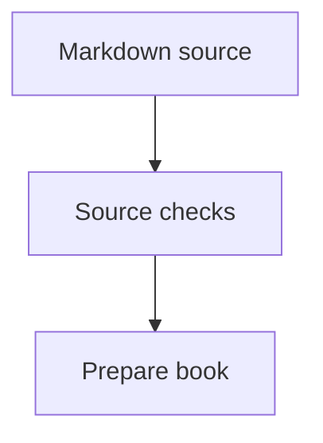
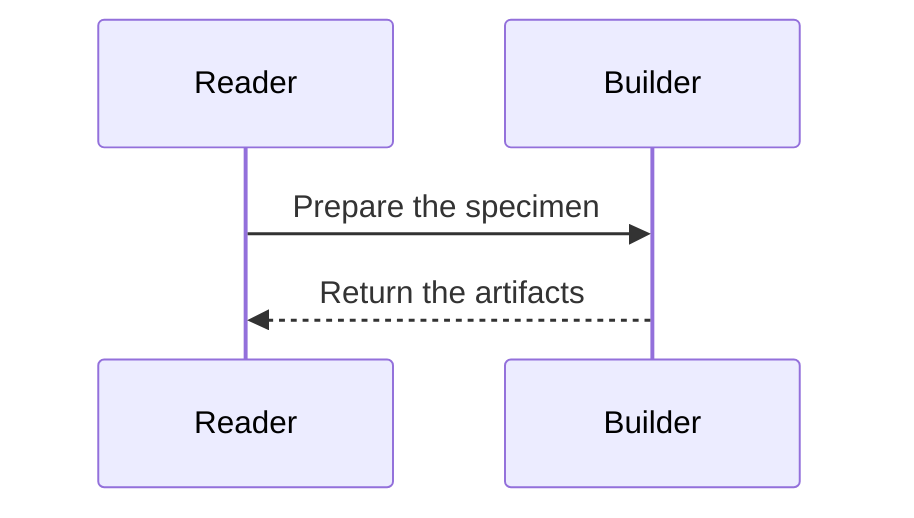

# Format a chapter across outputs

How can notes, wider material, and notation help the reader while preserving
one reading order? The accepted first rendering draft uses Markdown source for
responsive HTML, reflowable EPUB 3, a double-sided book PDF, and a one-sided A4
PDF. This reference describes the forms supported by that draft. The
[rendering guide](../../../../docs/project/rendering.md) owns tool versions,
page geometry, build commands, and replacement conditions.

Keep the explanation connected in the main text. A reader must be able to
follow its reasoning when notes move, columns collapse, or figures scale.
Use formatting to expose a relationship or make secondary material available
near its reference. A required definition, causal step, diagnostic, or exercise
instruction belongs in the main reading path.

## Choose the element

| Element | Use it for |
| --- | --- |
| Ordinary paragraph | The argument and what the reader must do or understand |
| Numbered note | A secondary clarification attached to a sentence |
| Full-width block | A short explanation or table needing more space |
| Diagram | A relationship whose structure helps explain the idea |
| Page break | A verified print grouping that needs a fresh page |

Use standard emphasis, inline code, lists, and tables within these forms.
Keep runnable Ash blocks connected to canonical source and checks as required
by the writing skill. Preserve complete diagnostics and program text; change
their presentation rather than abbreviating them to fit a page.

## Numbered sidenotes

Use Markdown footnote references and definitions. Short and longer notes use
the same source form:

```markdown
The main explanation stays in this paragraph.[^clarification]

[^clarification]: A short secondary clarification.

Continue the reasoning in the main text.[^detail]

[^detail]: A longer clarification can contain several sentences. Keep it
    secondary to the argument and indent continued lines by four spaces.
    The sentence with its reference should still make sense on its own.
```

Choose descriptive note identifiers and place each reference beside the words
it explains. The renderer supplies the visible numbers. Keep the definition
near the referring paragraph in source so an author can review them together.

Desktop HTML places notes on the right. The book PDF uses the outer margin,
alternating sides for double-sided printing. A4 keeps both short and longer
notes in its wider right margin. Narrow HTML moves notes into the reading
flow; EPUB uses linked notes with a return path. Do not author different note
text or manually position it for each output.

A longer secondary explanation can remain a sidenote. Check that it fits with
nearby notes in both PDFs at readable type size. If it crowds or overlaps them,
shorten the secondary material or develop the needed explanation in the main
text. Do not shrink the note's type to force it into the margin. Notes must not
disclose an observation that an exercise asks the reader to discover.

## Full-width material

Use a fenced Div with `.column-page-right` for a short paragraph, comparison
table, or formatting example that needs the main column and adjoining note
area. Give it a descriptive identifier:

```markdown


::: {#notation-comparison .column-page-right}
*Reading the notation.* The wider area keeps the comparison together.

| Notation | Relationship | Reading order |
| --- | --- | --- |
| Inference rule | Premises support a conclusion | Premises, then conclusion |
| Interaction sequence | Participants exchange messages | Follow message order |

:::
```

The block is part of the chapter's reading order. It is an unnumbered aside or
comparison, separate from a referenced sidenote. It spans the body and outer
note area in the book PDF, and the body and right note area in A4 and desktop
HTML. Binding space and HTML navigation stay outside it. Narrow HTML and EPUB
return it to their available reading width, so use content that can wrap.

Keep a wide block short enough for one page in both PDFs. The current print
implementation does not reliably handle wide blocks across mirrored page
breaks. Check that the complete paragraph and table stay together and do not
intersect sidenotes. If the material is longer, divide it at a meaningful
conceptual boundary or use the ordinary column.

The example uses the exact standalone directive ``, with
blank lines on both sides. Add it when an inspected print layout needs the
fresh page; it is not a default before every wide block or section. It starts
a new PDF page, carries a page-break request into EPUB, and leaves screen HTML
continuous. An EPUB reader controls physical pagination. Other Quarto
shortcodes are outside the current preparation contract.

## Diagrams and their descriptions

Choose the notation that expresses the relationship:

- Use `mermaid` for graphs and interaction sequences. A sequence diagram shows
  messages between participants.
- Use `ebnf` for a railroad grammar. Explain the choices, references, and
  repetitions the reader should follow.
- Use `sequent` for premises, a conclusion, and nested inference rules. This is
  the specialised sequent-calculus renderer with its own simplified notation.
  It is separate from Mermaid sequences and does not accept general LaTeX.

Use bare diagram fences at the top level of the chapter. The current adapter
does not convert diagrams nested in a list, note, or Div, including a
full-width Div. Introduce and interpret each figure in ordinary prose.

Each fence needs one entry in the chapter's YAML `diagrams` list. Match entries
to fences in source order. Give each entry `kind`, `id`, `caption`, and
`description`. IDs must be unique across the rendered book, start with a
lowercase letter, and contain only lowercase letters, digits, and hyphens.
Use the `fig-` prefix for figures.

The following complete Markdown example uses the notation exercised by the
[specimen](../../../../rendering/specimen/notation.md). Its letters and grammar
are rendering examples; they make no Ash language claim.

````markdown
---
diagrams:
  - kind: mermaid
    id: fig-preparation
    caption: Checks precede preparation.
    description: Markdown passes through source checks before book preparation.
  - kind: mermaid
    id: fig-request
    caption: A reader requests a book.
    description: The reader requests preparation and the builder returns artifacts.
  - kind: ebnf
    id: fig-name-list
    caption: Names can form a comma-separated list.
    description: A list has a name followed by repeated commas and names.
  - kind: sequent
    id: fig-nested-rule
    caption: A nested derivation supports another conclusion.
    description: P and P implies Q derive Q; Q and Q implies R then derive R.
---

The graph shows where preparation follows source checks.



The interaction sequence follows a request and its response.



The grammar shows alternatives and repetition.

```ebnf
list ::= name { "," name } ;
name ::= "alpha" | "beta" ;
```

The nested rule derives Q before using it to derive R.

```sequent
family examples:
  Nested :=
    [ P
      P -> Q
      ===>
      Q ]
    Q -> R
    ===>
    R
```
````

Captions state the point of the figure; descriptions communicate its relevant
relationships without relying on colour or spatial position alone. Both are
plain text in the current adapter. Keep source labels short enough to remain
legible when the figure scales. Supply a prose explanation even when a visual
pattern seems clear.

The build derives static SVG assets for every output. Their glyphs are outlined
shapes, so diagram labels are not selectable text. Captions and prose remain
text, and SVG descriptions retain the notation source. Diagrams must work
without scripts, animation, or external resources.

The sequent renderer has its own supported formula spellings and indentation.
Use its tested notation rather than assuming TeX commands or adding unsupported
symbol aliases. Indented formula continuations have a confirmed defect outside
bracketed derivations; retain a failing canonical case and consult the
[renderer report](../../../../docs/project/notation-renderer-bugs.md) when it
affects an example. Do not silently change the intended notation to conceal a
renderer failure.

## Review the reading experience

After adding special formatting, build the selected material through the
[rendering checks](../../../../docs/project/rendering.md#verify-the-specimen).
The current specimen renders only its configured lessons and notation fixture;
authoring supported Markdown does not by itself add a chapter to that build.

Inspect narrow HTML, EPUB with enlarged text, and both PDF variants. Check note
references and return links, reading order, table wrapping, figure labels,
complete code and diagnostics, wide-block pagination, and note collisions.
Check printed figures in grayscale. A successful desktop view alone does not
establish these properties. Browser EPUB checks cover reflow; publication also
needs inspection in the intended e-readers.
