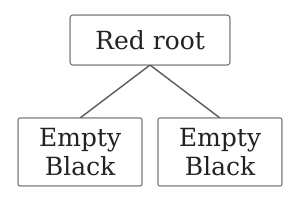
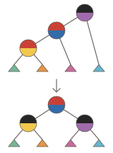
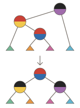
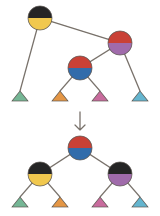
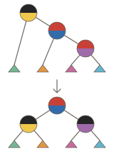
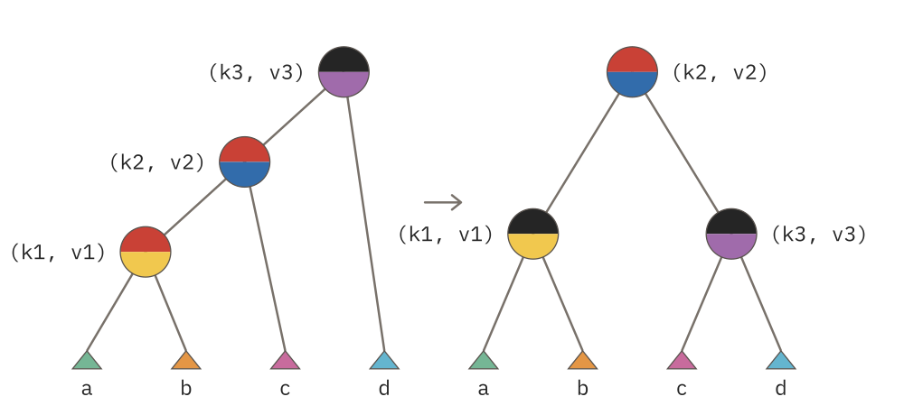

# How can the representation prevent a search tree from degenerating?

The dictionary from the preceding case hides its constructors, but insertion
can still build a long chain. Insert the associations `(3, 30)`, `(2, 20)`,
and `(1, 10)` into an empty dictionary. Ordered insertion puts `2` below the
left branch of `3`, then `1` below the left branch of `2`. Looking up `1` visits
all three nodes. Repeating that pattern gives height `h = n`: one ordered
branch can contain every key.

We want insertion to keep lookup paths short while retaining the same
associations. For these three keys, `2` can be the root, with `1` and `3` as
its children. Lookup still uses the key comparison from the preceding case.
The change belongs in how insertion constructs the tree.

A hidden color on each nonempty node will tell insertion when a local path
needs repair. We will develop that data, state the operations it needs, then
calculate their bodies using the three-association example. Insertion remains
persistent: it returns a new dictionary, leaving the earlier value available.



## Describe the colored data

The keys and values retain their meanings. A `Dictionary<K, V>` associates
keys of type `K` with values of type `V`. Its recursive alternatives tell us
whether there is an association at the current position. The following
non-executable declaration excerpt adds a color to the representation:

<!-- markdownlint-disable MD013 -->

<!-- excerpt: src/dictionaries.ash#representation -->

```text
type Color =
    Red
    | Black

pub opaque type Dictionary<K, V> =
    Empty
    | Node(Color, Dictionary<K, V>, K, V, Dictionary<K, V>)
```

<!-- markdownlint-enable MD013 -->

`Empty` has no association. `Node` contains a color, the left dictionary, a
key, its associated value, and the right dictionary, in that order. `K` and
`V` describe every association in that tree. We reuse `Natural`, `Option`,
`Ordering`, and the `Order<K>` comparison from the preceding case. The new
`Color` has exactly two alternatives, `Red` and `Black`.

A color is useful only with rules for interpreting it. `Empty` counts as
black.[^red-root-example] A black node adds one to the count on every path
below it; a red node adds none. We call the common count, including the
terminal `Empty`, the subtree's *black-height*. It measures the black forms
on a path, rather than all its nonempty nodes.

A subtree is recursively consistent when three conditions hold:

1. It has the global ordering invariant from the preceding case. Every left
   descendant is `Less` than the current key, and every right descendant is
   `Greater`.
2. A red node has no red child.
3. Every path from the subtree root to `Empty` contains the same number of
   black forms.

A recursively consistent subtree may have a red root. A completed public
dictionary adds one more condition: its root is black, unless the dictionary
is `Empty`. Separating that final condition lets red subtrees participate in
insertion. In the three-key result, a black `2` with black children `1` and `3`
meets all four conditions: every path counts the root, one black child, and
its terminal `Empty`, giving black-height three. A black `3` with only a red
left child `2` also has equal counts. The shorter right path counts `3` and
`Empty`; each longer left path counts the same two black forms. Equal
black-height therefore allows some difference in total path length. The
rule against adjacent red nodes limits how much longer a path can become.

<!-- markdownlint-disable MD013 -->

[^red-root-example]: Both paths contain one black form: their terminal `Empty`.
    A red root adds no black form.

    {#red-root-sketch fig-alt="A schematic red root has two Empty children, each counted as black. Each path contains one black form; the red root contributes none." width=100%}

<!-- markdownlint-enable MD013 -->

The opaque declaration controls source access. Importers can name
`Dictionary<K, V>`, but cannot name its constructors under Ash's
[public and opaque declaration rules](https://github.com/dikini/ash-lang/blob/9ec5920e8c395f9a36125805ee93b7f58c0f4764/spec/name-resolution.md#public-private-and-opaque-declarations).
The defining module can construct any of its forms, including invalid ones.
Neither the nominal type nor `Order<K>` proves the representation laws. We
must design the operations to preserve them.

## State the operations we need

Work out the function types before filling their bodies. In the following
type calculations, `D` abbreviates `Dictionary<K, V>` in the explanation;
it is not a new Ash type or a declaration in the program. The source
signatures keep the full spelling.

The public operation has the same job as before: insert a key and value into
a valid dictionary. If the comparison is `Equal`, replace that association's
value; otherwise add the association. Return a valid dictionary with all
other associations retained. We supply a key of type `K`, then a value of
type `V`, then a dictionary of type `D`; the result must also have type `D`.
Reading those inputs and the result in order gives `K -> V -> D -> D`.
Comparison needs `Order<K>`, so the signature includes that requirement.
The following source signature is a non-executable excerpt:

<!-- markdownlint-disable MD013 -->

<!-- signature: src/dictionaries.ash#insert -->

```text
pub insert : K -> V -> Dictionary<K, V> -> Dictionary<K, V> where Order<K>
```

<!-- markdownlint-enable MD013 -->

Insertion still descends through one ordered branch. We need an internal
operation that performs that descent while allowing a temporary red root or
an edge between two red nodes. Its input is a recursively consistent
subtree. Its result retains ordering and black-height, but may have a
red-red edge directly below its red root. A black ancestor must repair that
edge. The requirement on `Order<K>` supplies the comparison that selects the
branch. Its job still takes a `K`, a `V`, and a `D` and returns a `D`, so
`insert_colored` has the same function type as public insertion:

<!-- markdownlint-disable MD013 -->

<!-- signature: src/dictionaries.ash#insert_colored -->

```text
insert_colored : K -> V -> Dictionary<K, V> -> Dictionary<K, V> where Order<K>
```

<!-- markdownlint-enable MD013 -->

When recursion returns a child, the parent has its color, its two branches,
and its own association available. Carry the left dictionary and the parent's
key and value together, leaving the color and right dictionary as separate
inputs. This small private type gives that group a name:

<!-- excerpt: src/dictionaries.ash#repair_args -->

```text
type RArg<K, V> = RArg(Dictionary<K, V>, K, V)
```

`RArg` means repair argument. Its constructor takes a dictionary, a key, and
that key's value. The dictionary lies immediately before the association in
key order. Each group therefore describes one part of the ordered arrangement:
a subtree followed by an association. The type groups those values; it does
not establish their ordering or black-height conditions.

Rebuilding the parent now takes a `Color`, an `RArg<K, V>`, and a `D`, and
returns a `D`. Those successive inputs calculate the signature of `restore`,
which repairs a red-red edge beneath a black parent when it finds one:

::: {#wide-restore-signature .column-page-right}

<!-- signature: src/dictionaries.ash#restore -->

```text
restore : Color -> RArg<K, V> -> Dictionary<K, V> -> Dictionary<K, V>
```

:::

That repair rearranges three associations with four intervening subtrees.
Three `RArg` values carry the first three subtrees and their following
associations; one final `D` supplies the rightmost subtree. All four inputs
produce one `D`. The different orientations will supply these same groups to
one construction:

<!-- signature: src/dictionaries.ash#restore_three -->

```text
restore_three : (
    RArg<K, V> -> RArg<K, V> -> RArg<K, V> ->
    Dictionary<K, V> -> Dictionary<K, V>
)
```

The arrows still describe [successive calls](../../learn/using-more-than-one-input/README.md#supplying-two-inputs).
A constructed `RArg` is one argument to a call, so it has grouping parentheses
when passed to another function. Its fields have already been collected into
one value, like the [tuple inputs](../../learn/values-travel-together/README.md#receiving-one-pair)
from Learn.

Finally, internal insertion may return a red root. `blacken_root` restores
the public root condition without searching the tree or changing an
association. It receives one whole dictionary and returns one whole
dictionary, giving `D -> D`:

<!-- markdownlint-disable MD013 -->

<!-- signature: src/dictionaries.ash#blacken_root -->

```text
blacken_root : Dictionary<K, V> -> Dictionary<K, V>
```

<!-- markdownlint-enable MD013 -->

We can already check how these operations fit together. Once we supply
`key : K` and `value : V`, `insert_colored key value` has remaining type
`D -> D`. Give it a dictionary and its result has type `D`.
`blacken_root` accepts that result because its input type is also `D`.
Its output is `D`, which is exactly what public insertion promises.
We have calculated the connection between the two operations before
choosing either body. Ash checks application inputs and results under its
[function and application typing rules](https://github.com/dikini/ash-lang/blob/9ec5920e8c395f9a36125805ee93b7f58c0f4764/spec/static-semantics.md#functions-and-application).

These signatures describe the shapes of inputs and outputs. The purposes add
requirements that the types do not express. Completed dictionaries and
temporary insertion results have the same `Dictionary<K, V>` type; their
stated conditions differ. In particular, `restore` is a local repair for
candidates produced by insertion. It is not a general operation for
correcting an arbitrary malformed tree.

## Repair one colored path

We have the function types and the conditions each operation must maintain.
Now fill the public operation, follow its call into recursive insertion,
and develop the smaller repair it needs. The three-association example will
let us check each choice with a concrete tree.

The following calculations are schematic source calculations, not runnable
programs or tool output. Numerals stand for the corresponding `Natural`
keys; values such as `10` remain integers.

Begin with the public goal. The type calculation already tells us how the
two operations connect: obtain the internal insertion result, then pass that
whole dictionary to `blacken_root`. Assuming those operations do their
stated jobs, this expression gives public insertion the required result:

<!-- markdownlint-disable MD013 -->

<!-- excerpt: src/dictionaries.ash#insert -->

```text
pub insert : K -> V -> Dictionary<K, V> -> Dictionary<K, V> where Order<K>
insert key value dictionary = blacken_root (insert_colored key value dictionary)
```

<!-- markdownlint-enable MD013 -->

The body names the two remaining jobs. We can develop each one from its
promised input and result, starting with the insertion that produces the
dictionary for `blacken_root`.

### Insert into the recursive data

`insert_colored` must give public insertion a dictionary with the new or
replaced association. Its input is either `Empty` or `Node`, so those two
alternatives supply its first cases. At `Empty`, a new association needs
two empty children. The replaced `Empty` contributes one black form. A red
node above two `Empty` children also contributes one on each path, leaving
the count unchanged. A black node would make that count two on only the
entered branch. This determines the new node's red color and gives the
first expected result:

```text
insert_colored 1 10 Empty
=> Node(Red, Empty, 1, 10, Empty)
```

At a `Node`, comparison gives three cases. In the compact node pattern below,
`a` and `b` name the left and right dictionaries, while `k` and `v` name the
stored key and value. The separate `key` and `value` name the association being
inserted. For `Less`, recur on `a`. Its type is `D`, and
`insert_colored key value a` returns `D`. Assume this smaller call inserts the
association and preserves ordering and black-height, allowing a red-red edge
directly below a red root.

The returned dictionary belongs with the parent's association in
`RArg(insert_colored key value a, k, v)`. Pass that group to `restore` after
`color`, then supply `b` as the right dictionary. At a black parent, `restore`
can repair the returned child's edge; at a red parent, it reconstructs the
subtree for the enclosing ancestor. This calculates the combining expression
in the `Less` arm. `Greater` keeps `RArg(a, k, v)` and supplies the recursively
returned right dictionary. Each recursive input is a smaller child, so descent
through a finite dictionary reaches `Empty` or an equal key, provided the
comparisons return.

On `Equal`, inserting `(2, 99)` over `(2, 20)` retains the stored key,
children, and color, changing only the value. This supplies the middle arm
without recursion or repair. The completed excerpt is:

<!-- markdownlint-disable MD013 -->

::: {#wide-insert-colored-excerpt .column-page-right}

<!-- excerpt: src/dictionaries.ash#insert_colored -->

```text
insert_colored : K -> V -> Dictionary<K, V> -> Dictionary<K, V> where Order<K>
insert_colored key value Empty = Node(Red, Empty, key, value, Empty)
insert_colored key value Node(color, a, k, v, b) = match compare key k {
    Less => restore color (RArg(insert_colored key value a, k, v)) b
    Equal => Node(color, a, k, value, b)
    Greater => restore color (RArg(a, k, v)) (insert_colored key value b)
}
```

:::

<!-- markdownlint-enable MD013 -->

### Repair the returned child

Insertion asks `restore` to rebuild a parent with one child replaced by the
recursive result. A black parent may receive a red child with a red child of
its own. The two red nodes can follow left-left, left-right, right-left, or
right-right branches. These are the function's four repair cases. We will
follow each equation separately, then add a fallback for candidates that need
no local repair.

Every case must retain the same three associations and four intervening
subtrees. Short names let us compare the input pattern with the reconstruction:
`a`, `b`, `c`, `d` are the subtrees from left to right; `k` means key and `v`
means value. `(k1, v1)`, `(k2, v2)`, `(k3, v3)` are the associations in increasing
key order. The indices indicate that order, rather than literal key values or
insertion order:

```text
a, (k1, v1), b, (k2, v2), c, (k3, v3), d
```

Each case collects the first three subtree-and-association groups into `RArg`
values and leaves `d` separate. The shared helper will place the middle
association above black first and last nodes. For now, its promised result
lets us calculate the calls that each case needs.

The optional sketches show each candidate above its repaired result. The
upper half of a circle records red or black; the lower color follows that
association as it moves. Colored triangles stand for the surrounding subtrees.
The same colors appear before and after, so you can trace the rewiring without
reading names inside the diagram.



**Left-left.**[^restore-left-left] Inserting `3, 2, 1` gives our running
candidate: black `3` above red `2` above red `1`, following left branches. The
black parent supplies the last association, `(k3, v3)`; its red child supplies
the middle, `(k2, v2)`; and the red grandchild supplies the first, `(k1, v1)`.
The remaining fields name `a`, `b`, `c`, and `d` in their ordered positions:

<!-- excerpt: src/dictionaries.ash#restore_left_left -->

```text
restore Black RArg(
    Node(Red, Node(Red, a, k1, v1, b), k2, v2, c),
    k3,
    v3
) d = (restore_three
        (RArg(a, k1, v1))
        (RArg(b, k2, v2))
        (RArg(c, k3, v3))
        d
    )
```

<!-- markdownlint-disable MD013 -->

[^restore-left-left]: Left-left repair: before above, after below.

    {#restore-left-left-sketch fig-alt="Before above: black violet above a red blue left child and a red yellow left grandchild. After below: red blue above black yellow and black violet. The green, orange, pink, and cyan subtrees retain their left-to-right order." width=100%}

<!-- markdownlint-enable MD013 -->

The repeated groups on the right show what survives the pattern. In this
example, all four subtrees are `Empty`. The bindings supply this schematic
call to the helper:

```text
restore_three
    (RArg(Empty, 1, 10))
    (RArg(Empty, 2, 20))
    (RArg(Empty, 3, 30))
    Empty
=> red 2 above black 1 and black 3, with the same values
```

**Left-right.**[^restore-left-right] Inserting `3, 1, 2` still puts the last
association at the black parent. Its red left child now supplies the first
association. The child's red right branch supplies the middle. The second
pattern selects that changed position, then sends the same ordered groups to
the helper:

<!-- excerpt: src/dictionaries.ash#restore_left_right -->

```text
restore Black RArg(
    Node(Red, a, k1, v1, Node(Red, b, k2, v2, c)),
    k3,
    v3
) d = (restore_three
        (RArg(a, k1, v1))
        (RArg(b, k2, v2))
        (RArg(c, k3, v3))
        d
    )
```

<!-- markdownlint-disable MD013 -->

[^restore-left-right]: Left-right repair: before above, after below.

    {#restore-left-right-sketch fig-alt="Before above: black violet above a red yellow left child, whose right child is red blue. After below: red blue above black yellow and black violet. The green, orange, pink, and cyan subtrees retain their left-to-right order." width=100%}

<!-- markdownlint-enable MD013 -->

The destination remains red middle above black first and last. Only the
fields from which we obtain the groups have changed.



**Right-left.**[^restore-right-left] Inserting `1, 3, 2` puts the first
association at the black parent and the last at its red right child. The
child's red left branch supplies the middle. The parent's group already
contains `a`, `k1`, and `v1`; the nested right pattern supplies the remaining
pieces:

<!-- excerpt: src/dictionaries.ash#restore_right_left -->

```text
restore Black RArg(a, k1, v1) Node(
    Red,
    Node(Red, b, k2, v2, c),
    k3,
    v3,
    d
) = (restore_three
        (RArg(a, k1, v1))
        (RArg(b, k2, v2))
        (RArg(c, k3, v3))
        d
    )
```

<!-- markdownlint-disable MD013 -->

[^restore-right-left]: Right-left repair: before above, after below.

    {#restore-right-left-sketch fig-alt="Before above: black yellow above a red violet right child, whose left child is red blue. After below: red blue above black yellow and black violet. The green, orange, pink, and cyan subtrees retain their left-to-right order." width=100%}

<!-- markdownlint-enable MD013 -->

Here `b` and `c` come from the middle node's children. Their names retain
the same ordered positions as in the preceding cases, so the reconstruction
call is unchanged.

**Right-right.**[^restore-right-right] Inserting `1, 2, 3` puts the first
association at the black parent, the middle at its red right child, and the
last at that child's red right branch. This is the final orientation:

<!-- excerpt: src/dictionaries.ash#restore_right_right -->

```text
restore Black RArg(a, k1, v1) Node(
    Red,
    b,
    k2,
    v2,
    Node(Red, c, k3, v3, d)
) = (restore_three
        (RArg(a, k1, v1))
        (RArg(b, k2, v2))
        (RArg(c, k3, v3))
        d
    )
```

<!-- markdownlint-disable MD013 -->

[^restore-right-right]: Right-right repair: before above, after below.

    {#restore-right-right-sketch fig-alt="Before above: black yellow above a red blue right child and a red violet right grandchild. After below: red blue above black yellow and black violet. The green, orange, pink, and cyan subtrees retain their left-to-right order." width=100%}

<!-- markdownlint-enable MD013 -->

The four equations differ in where they find the first, middle, and last
associations. Each requests the same reconstruction after collecting them.

**When no repair case matches.** Inserting `2` below black `3` creates only
one red child, so there is no red-red edge to repair. Reconstruct the node
from the supplied fields. The same fallback also reconstructs a red parent;
if its child is red, an enclosing black ancestor will handle that edge:

<!-- excerpt: src/dictionaries.ash#restore_unchanged -->

```text
restore color RArg(a, k, v) b = Node(color, a, k, v, b)
```

Ash tries these patterns in source order and selects the first matching
equation once the arguments have arrived. The final equation handles every
remaining color and subtree shape. The
[pattern and coverage rules](https://github.com/dikini/ash-lang/blob/9ec5920e8c395f9a36125805ee93b7f58c0f4764/spec/static-semantics.md#patterns-matches-and-coverage)
check that the equations cover the input type. The
[evaluation rules for matches and equations](https://github.com/dikini/ash-lang/blob/9ec5920e8c395f9a36125805ee93b7f58c0f4764/spec/dynamic-semantics.md#tuples-constructors-and-matches)
explain which body executes. Neither check establishes the ordering or
black-height premises used in the repair calculation.

### Construct the shared repair result

`restore_three` receives three `RArg` values and the final subtree `d`. Unpack
the groups to name `a`, `b`, `c`, their keys, and their values. The middle
association separates the first two subtrees from the last two. Place the
first association above `a` and `b`, and the last above `c` and `d`. Those two
constructed dictionaries become the middle node's children.

Give the first and last nodes black colors to remove the red-red edge and
allow red-rooted surrounding subtrees. Keep the middle root red to retain
the black-height. For the running example, the four subtrees are `Empty`
and the associations are `(1, 10)`, `(2, 20)`, and `(3, 30)`. The expected
local result makes the construction concrete:

```text
Node(
    Red,
    Node(Black, Empty, 1, 10, Empty),
    2,
    20,
    Node(Black, Empty, 3, 30, Empty)
)
```

This is the result of the local repair, before public insertion blackens its
root. Each value stays with its key. The drawing uses `A`, `B`, `C`, and `D`
for the same subtrees named `a`, `b`, `c`, and `d` in the program:

<!-- markdownlint-disable MD013 -->

::: {#repair-comparison .column-page-right}

{#fig-tree-repair fig-alt="Before left-left repair, a black last node has red middle and first nodes down its left branch. First has subtrees A and B; middle has C on its right; last has D on its right. After repair, red middle has black first and last children. First retains A and B, and last retains C and D. Each key stays with its value." width=100%}

:::

<!-- markdownlint-enable MD013 -->



The ordering tells us where each subtree belongs. `A` and `B` stay below the
first key. `C` and `D` become the children of the last key. The middle key
separates those two constructed dictionaries. Each subtree must retain its
inherited key bounds: `A` below the first key, `B` between first and middle,
`C` between middle and last, and `D` above the last key. Their roots may be
red; making the first and last nodes black also prevents a new red-red edge
where those subtrees attach.

In the following definition, the three repeated `let` patterns unpack the
input groups; the final expression rebuilds their components in the arrangement
we just calculated. The local names retain the
legend: ordered subtrees `a`, `b`, `c`, `d` and associations `(k1, v1)`,
`(k2, v2)`, `(k3, v3)`:

<!-- markdownlint-disable MD013 -->

<!-- excerpt: src/dictionaries.ash#restore_three -->

```text
restore_three : (
    RArg<K, V> -> RArg<K, V> -> RArg<K, V> ->
    Dictionary<K, V> -> Dictionary<K, V>
)
restore_three first second third d = {
    let RArg(a, k1, v1) = first
    let RArg(b, k2, v2) = second
    let RArg(c, k3, v3) = third
    Node(
        Red,
        Node(Black, a, k1, v1, b),
        k2,
        v2,
        Node(Black, c, k3, v3, d)
    )
}
```

<!-- markdownlint-enable MD013 -->

This definition is a non-executable excerpt from the complete companion
module. Its three local patterns each bind their own input group under Ash's
[block and pattern rules](https://github.com/dikini/ash-lang/blob/9ec5920e8c395f9a36125805ee93b7f58c0f4764/spec/static-semantics.md#blocks).
It constructs three dictionary nodes and passes the four subtree values
unchanged into them. It needs no comparison: its caller must supply the
associations and subtrees in the required order.

For the insertion candidates we will produce, the four surrounding subtrees
are recursively consistent and have one common black-height. The candidate
may contain the one red-red edge being repaired. If the common height is
`q`, the former black grandparent contributes one, giving `q + 1` on every
path. The result's black children each contribute one and its red root
contributes none, so every path still has `q + 1`. This calculation explains
why the colors in the body preserve the count.

### Restore the public root condition

Internal insertion has kept the associations ordered and the path counts
equal, but our calculated root is red. `blacken_root` has three meaningful
inputs: `Empty`, a black node, or a red node. The first two already meet the
public root condition and should be returned unchanged. For a red node,
retain its association and both children and change only its color:

<!-- markdownlint-disable MD013 -->

<!-- excerpt: src/dictionaries.ash#blacken_root -->

```text
blacken_root : Dictionary<K, V> -> Dictionary<K, V>
blacken_root dictionary = match dictionary {
    Empty => Empty
    Node(Black, ignored_left, ignored_key, ignored_value, ignored_right) => dictionary
    Node(Red, left, key, value, right) => Node(Black, left, key, value, right)
}
```

<!-- markdownlint-enable MD013 -->

For our local result, that final case returns black `2` with black `1` and
`3` beneath it. Every path gains the same one black form. Recoloring the
root changes neither ordering nor key-value associations.

### Assemble and run the example

Starting with `Empty`, inserting `(3, 30)` creates red `3`, then blackens it.
Inserting `(2, 20)` leaves black `3` with a red left child because no repair
pattern fits. Inserting `(1, 10)` now selects `Less` at both nodes.
At `Empty`, the first equation returns red `1`. The pending reconstruction
at `2` receives that result:

```text
restore Red (RArg(Node(Red, Empty, 1, 10, Empty), 2, 20)) Empty
=> Node(Red, Node(Red, Empty, 1, 10, Empty), 2, 20, Empty)
```

Its parent color is red, so none of the four repair equations fits; the
fallback produces the temporary red-red edge. The next pending
reconstruction, at black `3`, receives the candidate derived for the
left-left repair. Its first pattern selects `restore_three`, which returns
red `2` with black `1` and `3` as children.

The nested recursive expression is evaluated before `restore` receives that
child value, under Ash's strict
[application rules](https://github.com/dikini/ash-lang/blob/9ec5920e8c395f9a36125805ee93b7f58c0f4764/spec/dynamic-semantics.md#application).
The calculation therefore descends through comparisons, then reconstructs
from the returned child toward the root. A repair can return a red root
beneath a red ancestor; the next black grandparent handles that edge.
Starting from a valid black-rooted dictionary ensures that any such edge
has a black grandparent before the internal result reaches the top.

The final `blacken_root` call changes the returned red `2` to black. Predict
that black root with black children `1` and `3`, and the original values
`10`, `20`, and `30` still paired with their keys.

The complete client below names the three `Natural` keys explicitly and uses
only public operations. The `impl Order` import item supplies the public
ordering implementation, as in the preceding case.

<!-- markdownlint-disable MD013 -->

<!-- source: src/03-repair.ash -->

```ash
import dictionaries (Dictionary, Natural, Zero, Next, empty, insert, impl Order)

main : Unit -> Dictionary<Natural, Int>
main () = {
    let one = Next(Zero)
    let two = Next(one)
    let three = Next(two)
    let after_three = insert three 30 (empty ())
    let after_two = insert two 20 after_three
    insert one 10 after_two
}
```

<!-- markdownlint-enable MD013 -->

Run it from `content/cases`:

```text
ash guaranteeing-logarithmic-retrieval/src/03-repair.ash
```

<!-- markdownlint-disable MD013 -->

```text
Node(Black, Node(Black, Empty, Next(Zero), 10, Empty), Next(Next(Zero)), 20, Node(Black, Empty, Next(Next(Next(Zero))), 30, Empty)) : Dictionary<Natural, Int>
```

<!-- markdownlint-enable MD013 -->

The printed tree makes each predicted association and color visible. Opacity
prevents the client from constructing or matching these nodes; the tool can
still display the returned value. The result checks this particular
calculation. It does not establish preservation for every dictionary.

The [complete dictionary module](src/dictionaries.ash) also contains the
ordering and balance checks used later in the chapter. `valid_between`
checks inherited key bounds. A separate pass obtains each child's
black-height, rejects red-red edges and unequal counts, and a final check
examines the root. Both passes bind both recursive child results before
combining them. Ash's strict
[binding rules](https://github.com/dikini/ash-lang/blob/9ec5920e8c395f9a36125805ee93b7f58c0f4764/spec/dynamic-semantics.md#bindings)
mean that a completed validation enters both branches.

The defining module's private `main` constructs five trees to distinguish
these checks. Predict one `true` followed by four `false` values:

- a valid one-node black tree;
- a deeper key beyond an inherited ordering bound;
- a red root whose recursive properties otherwise hold;
- a red parent with red children whose ordering and black-height hold; and
- two root paths with different black counts.

Run the complete companion directly from `content/cases`:

```text
ash guaranteeing-logarithmic-retrieval/src/dictionaries.ash
```

```text
(true, false, false, false, false) : (Bool, Bool, Bool, Bool, Bool)
```

This observation distinguishes the selected malformed values from the valid
one. The finite examples supplement the ordering and black-height
calculations; they do not replace the argument about what repair preserves.

This functional insertion strategy takes conceptual inspiration from the
tradition evaluated in the
[persistent red-black insertion record](../../../research/persistent-red-black-insertion.md).
The Ash program, diagram, derivation, examples, and exercises here are original.

## Check every selected insertion prefix

The repair calculation ended with a valid dictionary containing `(3, 30)`,
`(2, 20)`, and `(1, 10)`. Could a final successful lookup hide a problem after
an earlier insertion? Starting from the empty dictionary, we want observations
after `3`, after `3, 2`, and after `3, 2, 1`. Each is an insertion prefix: an
initial part of the same input sequence.

After inserting `(1, 10)`, finding that association is only one part of the
answer. The dictionary must also retain earlier associations, keep its ordering
and color conditions, and return no value for a key we never inserted. We will
calculate a client that records selected facts after each step, then checks
every association in the final dictionary.

### Describe the input and observations

The input is a `List<(Natural, Int)>`: each element pairs a key with its expected
value. For our three-step example, those pairs are `(3, 30)`, `(2, 20)`, and
`(1, 10)`, in that order. We also choose `(3, 30)` as the first association to
retain, and `0` as an absent key. These numbers stand for the `Natural` values
whose constructor forms we used in the repair client.

The report needs three new data types. `PrefixCheck` groups four Boolean
observations about one dictionary, in this order:

1. Its ordering, root color, red-child colors, and black-height satisfy the
   invariant.
2. Lookup of the key just inserted returns its expected value.
3. Lookup of the first inserted key still returns its expected value.
4. Lookup of the selected absent key returns `None`.

`Scenario` groups the empty dictionary's invariant check, the list of those
prefix checks, and a final list of association checks followed by the absence
check. Keeping these observations separate lets us locate a failure in the
run. A `true` invariant alone cannot tell us whether a value stayed with its
key.

`PrefixRun` serves a different purpose inside the client. It returns the prefix
checks together with the final dictionary, so another operation can examine
that dictionary. The type keeps these two results together without exposing
the dictionary's hidden constructors.

The client uses the familiar complete import for qualified public names and
selects `Order` implementations separately:

<!-- excerpt: src/01-prefix-matrix.ash#imports -->

```text
import dictionaries as Dictionaries
import dictionaries (impl Order)
```



The three report declarations are non-executable excerpts from the
[complete client](src/01-prefix-matrix.ash):

<!-- excerpt: src/01-prefix-matrix.ash#representation -->

```text
type PrefixCheck =
    PrefixCheck(Bool, Bool, Bool, Bool)

type Scenario =
    Scenario(Bool, Dictionaries.List<PrefixCheck>, Dictionaries.List<Bool>)

type PrefixRun =
    PrefixRun(
        Dictionaries.List<PrefixCheck>,
        Dictionaries.Dictionary<Dictionaries.Natural, Int>
    )
```

`List` still has its ending form `End` and its `More` form containing one
element and the rest. `Option` still distinguishes `None` from `Some`.
What is new here is the purpose and order of the report fields, rather than
another form of list or optional value. The Boolean types describe the shape
of an observation; they do not establish that it will be `true`.

For the selected runs, keys are distinct, the retained pair is the first input
pair, and the absent key does not occur in the input. Those choices make the
expected report meaningful. If a later entry replaced a value for the same
key, checking the earlier value in the final dictionary would correctly return
`false`. Replacement belongs to the next example.

### Choose the operation types

Start with the result we want. `scenario` consumes the entry list, the retained
key and its expected value, and the absent key. It returns a `Scenario`:

<!-- markdownlint-disable MD013 -->

::: {#wide-prefix-scenario-signature .column-page-right}

<!-- signature: src/01-prefix-matrix.ash#scenario -->

```text
scenario : Dictionaries.List<(Dictionaries.Natural, Int)> -> Dictionaries.Natural -> Int -> Dictionaries.Natural -> Scenario
```

:::

<!-- markdownlint-enable MD013 -->

Its body must begin with an empty dictionary and somehow obtain both the
intermediate observations and the final dictionary. Give that task to
`prefix_run`. Its inputs are the same four pieces of scenario information,
followed by the dictionary to continue from. Its result must be `PrefixRun`,
not just a list of checks, because the caller still needs the final dictionary:

<!-- markdownlint-disable MD013 -->

::: {#wide-prefix-prefix-run-signature .column-page-right}

<!-- signature: src/01-prefix-matrix.ash#prefix_run -->

```text
prefix_run : Dictionaries.List<(Dictionaries.Natural, Int)> -> Dictionaries.Natural -> Int -> Dictionaries.Natural -> Dictionaries.Dictionary<Dictionaries.Natural, Int> -> PrefixRun
```

:::

<!-- markdownlint-enable MD013 -->

Supplying the entries, retained pair, and absent key leaves a function from
`Dictionary<Natural, Int>` to `PrefixRun`. In the recursive case we can supply
the smaller remainder of the entries and the updated dictionary to that same
operation. The type tells us what can connect; the calculation must determine
what each check means and which dictionary to pass.

Lookup returns an optional value. We need two short operations to turn that
answer into a Boolean observation. `has_value` receives an expected `Int` and
an `Option<Int>`; it must report whether the value was found and agrees:

<!-- signature: src/01-prefix-matrix.ash#has_value -->

```text
has_value : Int -> Dictionaries.Option<Int> -> Bool
```

`is_none` receives an optional value and reports whether it is absent. It does
not inspect the payload, so its signature can retain the type parameter `A`:

<!-- signature: src/01-prefix-matrix.ash#is_none -->

```text
is_none : Dictionaries.Option<A> -> Bool
```

Finally, `lookup_checks` consumes the complete entry list, the absent key, and
one final dictionary. It returns a list of Boolean observations:

<!-- markdownlint-disable MD013 -->

::: {#wide-prefix-lookup-checks-signature .column-page-right}

<!-- signature: src/01-prefix-matrix.ash#lookup_checks -->

```text
lookup_checks : Dictionaries.List<(Dictionaries.Natural, Int)> -> Dictionaries.Natural -> Dictionaries.Dictionary<Dictionaries.Natural, Int> -> Dictionaries.List<Bool>
```

:::

<!-- markdownlint-enable MD013 -->

We have now described every operation needed by `scenario`. Fill their bodies
from the overall result toward the smaller tasks.



### Assemble a scenario

Create the empty dictionary with the concrete key and value types. Passing it
to `prefix_run` produces a `PrefixRun`. Matching that result supplies `checks`
and `final_dictionary` with the types required by the report. The empty
invariant check is a `Bool`, `checks` is a `List<PrefixCheck>`, and applying
`lookup_checks` to the original entries and final dictionary supplies the
`List<Bool>`. Those are precisely `Scenario`'s three fields:

<!-- markdownlint-disable MD013 -->

::: {#wide-prefix-scenario-excerpt .column-page-right}

<!-- excerpt: src/01-prefix-matrix.ash#scenario -->

```text
scenario : Dictionaries.List<(Dictionaries.Natural, Int)> -> Dictionaries.Natural -> Int -> Dictionaries.Natural -> Scenario
scenario entries retained_key retained_value absent_key = {
    let empty : Dictionaries.Dictionary<Dictionaries.Natural, Int> = Dictionaries.empty()
    let run = prefix_run entries retained_key retained_value absent_key empty
    match run {
        PrefixRun(checks, final_dictionary) => Scenario(
            Dictionaries.invariant_holds empty,
            checks,
            lookup_checks entries absent_key final_dictionary
        )
    }
}
```

:::

<!-- markdownlint-enable MD013 -->

The entry list has two uses. `prefix_run` consumes it to construct successive
dictionaries. `lookup_checks` uses it as the associations to expect in the
finished value. The final pass can therefore check all earlier associations,
not just the first and the latest ones.

### Record the next prefix and continue

`prefix_run` follows the entry list's two forms. With `End`, there is no next
insertion and no new prefix check. The required result is `PrefixRun(End,
dictionary)`: retain the supplied dictionary and return an empty check list.

With `More(entry, rest)`, split the entry into `key` and `value`. Inserting that
pair into `dictionary` returns `next_dictionary` of the same dictionary type.
All four observations must examine this returned value. Checking the old
`dictionary` would answer questions about the preceding prefix.

The four stated positions of `PrefixCheck` now determine the meanings of its
Boolean expressions: validate `next_dictionary`, look up the new key and value,
look up the retained key and value, then look up the absent key. The two small adapters
already have the types needed to interpret those lookups.



The remaining work has the same form as the original task, with the smaller
list `rest`. Assume that calling `prefix_run` on that remainder and
`next_dictionary` returns its checks in insertion order and the dictionary
after all remaining entries. Match that result, place `current_check` before
`later_checks`, and return the same `final_dictionary`. This determines the
complete equations:

<!-- markdownlint-disable MD013 -->

::: {#wide-prefix-prefix-run-excerpt .column-page-right}

<!-- excerpt: src/01-prefix-matrix.ash#prefix_run -->

```text
prefix_run : Dictionaries.List<(Dictionaries.Natural, Int)> -> Dictionaries.Natural -> Int -> Dictionaries.Natural -> Dictionaries.Dictionary<Dictionaries.Natural, Int> -> PrefixRun
prefix_run Dictionaries.End retained_key retained_value absent_key dictionary = PrefixRun(
    Dictionaries.End,
    dictionary
)
prefix_run Dictionaries.More(entry, rest) retained_key retained_value absent_key dictionary = match entry {
    (key, value) => {
        let next_dictionary = Dictionaries.insert key value dictionary
        let current_check = PrefixCheck(
            Dictionaries.invariant_holds next_dictionary,
            has_value value (Dictionaries.lookup key next_dictionary),
            has_value retained_value (Dictionaries.lookup retained_key next_dictionary),
            is_none (Dictionaries.lookup absent_key next_dictionary)
        )
        let later_run = prefix_run rest retained_key retained_value absent_key next_dictionary
        match later_run {
            PrefixRun(later_checks, final_dictionary) => PrefixRun(
                Dictionaries.More(current_check, later_checks),
                final_dictionary
            )
        }
    }
}
```

:::

<!-- markdownlint-enable MD013 -->

The base case supplies the promise for an empty remainder. The recursive case
adds one observation to the front of the returned list, so the list order
remains the insertion order. For a finite entry list, each call removes one
`More`; the recursion reaches `End`, provided insertion and the checks return.
The function records every Boolean result and continues even if one is
`false`.

Each invariant check visits the whole current dictionary. This observation
client therefore does more work than its insertions alone. The logarithmic
bound later in the chapter concerns the search path; validation has its own
cost.

The [global scope rules](https://github.com/dikini/ash-lang/blob/9ec5920e8c395f9a36125805ee93b7f58c0f4764/spec/name-resolution.md#global-scope)
allow these bodies to call helpers defined later in the complete source.
The [function and application rules](https://github.com/dikini/ash-lang/blob/9ec5920e8c395f9a36125805ee93b7f58c0f4764/spec/static-semantics.md#functions-and-application)
check that the argument and result types fit. The list-order promise comes
from the equations we just calculated.

### Interpret the optional lookup results

For `has_value`, `None` cannot be the expected association. `Some(actual)`
contains an `Int`, so compare it with `expected`:

<!-- excerpt: src/01-prefix-matrix.ash#has_value -->

```text
has_value : Int -> Dictionaries.Option<Int> -> Bool
has_value expected Dictionaries.None = false
has_value expected Dictionaries.Some(actual) = expected == actual
```

For example, `has_value 30 (Some(30))` is `true`, while both
`has_value 30 None` and `has_value 30 (Some(31))` are `false`. These are
calculations from the two equations, rather than additional CLI observations.

For `is_none`, the `None` case is the successful absence observation; any
present payload makes it false:

<!-- excerpt: src/01-prefix-matrix.ash#is_none -->

```text
is_none : Dictionaries.Option<A> -> Bool
is_none Dictionaries.None = true
is_none Dictionaries.Some(ignored_value) = false
```

The payload's value and type do not affect that answer. These two small
functions let the caller distinguish an absent association, a present wrong
value, and the expected value.

### Recheck every final association

The four prefix flags inspect the new association, one retained association,
and an absent key. After inserting `1`, they do not separately inspect `2`.
A final pass must therefore compare every input association against the final
dictionary.

`lookup_checks` also follows the list's two forms. With `More(entry, rest)`,
look up this entry's key in the same final dictionary, compare its value, and
place that Boolean before the checks for `rest`. With `End`, all associations
have been examined; return a one-element list containing the absent-key
check. The result has one flag per entry followed by that final absence flag:

<!-- markdownlint-disable MD013 -->

::: {#wide-prefix-lookup-checks-excerpt .column-page-right}

<!-- excerpt: src/01-prefix-matrix.ash#lookup_checks -->

```text
lookup_checks : Dictionaries.List<(Dictionaries.Natural, Int)> -> Dictionaries.Natural -> Dictionaries.Dictionary<Dictionaries.Natural, Int> -> Dictionaries.List<Bool>
lookup_checks Dictionaries.End absent_key dictionary = Dictionaries.More(
    is_none (Dictionaries.lookup absent_key dictionary),
    Dictionaries.End
)
lookup_checks Dictionaries.More(entry, rest) absent_key dictionary = match entry {
    (key, value) => Dictionaries.More(
        has_value value (Dictionaries.lookup key dictionary),
        lookup_checks rest absent_key dictionary
    )
}
```

:::

<!-- markdownlint-enable MD013 -->

For the running example, the list positions refer to `(3, 30)`, `(2, 20)`,
`(1, 10)`, and absence of `0`. To see why the middle check matters, consider
a dictionary containing only `(3, 30)` and `(1, 10)`. It can satisfy the
invariant, contain the new `1` and retained `3`, and omit `0`, yet the check
for `(2, 20)` must be `false`. This is a deliberately incomplete dictionary,
not the result of our insertion run. It distinguishes what the final pass
asks from what the four local flags ask.

### Assemble the inputs and read the result

The complete client's `main` returns six `Scenario` values:

<!-- markdownlint-disable MD013 -->

<!-- signature: src/01-prefix-matrix.ash#main -->

```text
main : Unit -> (Scenario, Scenario, Scenario, Scenario, Scenario, Scenario)
```

<!-- markdownlint-enable MD013 -->

It begins by constructing the seven `Natural` keys. These lines are an excerpt
from inside `main`, so their indentation is retained:

<!-- excerpt: src/01-prefix-matrix.ash#keys -->

```text
    let one = Dictionaries.Next(Dictionaries.Zero)
    let two = Dictionaries.Next(one)
    let three = Dictionaries.Next(two)
    let four = Dictionaries.Next(three)
    let five = Dictionaries.Next(four)
    let six = Dictionaries.Next(five)
    let seven = Dictionaries.Next(six)
```

The running input is the list whose first entry is `(three, 30)` and whose
remainder contains `(two, 20)` and `(one, 10)`:

<!-- markdownlint-disable MD013 -->

<!-- excerpt: src/01-prefix-matrix.ash#left_left -->

```text
    let left_left = Dictionaries.More(
        (three, 30),
        Dictionaries.More((two, 20), Dictionaries.More((one, 10), Dictionaries.End))
    )
```

<!-- markdownlint-enable MD013 -->

The complete source also constructs ascending and descending seven-key lists
and the other three repair orientations. Its final tuple supplies each list,
its first association, and `Zero` as the absent key:

<!-- excerpt: src/01-prefix-matrix.ash#matrix_calls -->

```text
    (
        scenario ascending one 10 Dictionaries.Zero,
        scenario descending seven 70 Dictionaries.Zero,
        scenario left_left three 30 Dictionaries.Zero,
        scenario left_right three 30 Dictionaries.Zero,
        scenario right_left one 10 Dictionaries.Zero,
        scenario right_right one 10 Dictionaries.Zero
    )
```

Predict `true` for each empty check and all four flags after each insertion.
The final list should also contain only `true`: every exact association remains
available, and `Zero` remains absent. Run the complete client from
`content/cases`:

```text
ash guaranteeing-logarithmic-retrieval/src/01-prefix-matrix.ash
```

The command returns one tuple containing all six scenarios. Read the
left-left scenario, the third tuple element, in smaller parts below. Each
fence contains a field or list element of that same captured value; the
surrounding tuple, `Scenario` constructor, and other fields are omitted. These
are selected observations, not separate program outputs.

Before any insertion, the scenario's first field is the empty invariant check:

<!-- observation: prefix-matrix#left_left.empty -->

```text
true
```

After `(3, 30)`, its first prefix check is:

<!-- observation: prefix-matrix#left_left.prefix_1 -->

```text
PrefixCheck(true, true, true, true)
```

Read the four positions as invariant, `(3, 30)`, retained `(3, 30)`, and
absence of `0`. The second and third positions test the same association at
this first step; their jobs differ once another entry is inserted.

After `(2, 20)`, the next prefix check is:

<!-- observation: prefix-matrix#left_left.prefix_2 -->

```text
PrefixCheck(true, true, true, true)
```

Now the second position checks `(2, 20)` and the third checks the earlier
`(3, 30)`. The first and fourth positions continue to check the invariant
and absence of `0` in this two-entry dictionary.

After `(1, 10)`, the third prefix check is:

<!-- observation: prefix-matrix#left_left.prefix_3 -->

```text
PrefixCheck(true, true, true, true)
```

The repair has preserved the invariant and the new and retained associations.
The final pass then examines all three pairs in input order, followed by
absence of `0`:

<!-- observation: prefix-matrix#left_left.lookups -->

```text
More(true, More(true, More(true, More(true, End))))
```

Each `More` supplies the next Boolean and the final `End` ends the list. The
second flag checks the middle association `(2, 20)`, which the last prefix's
four local flags did not inspect separately.

The same captured tuple gives the following counts. Each prefix check contains
four `true` flags, and every final flag is `true`:

<!-- summary: prefix-matrix -->

| Input order | Empty | Prefix checks | Final flags |
| --- | --- | --- | --- |
| Ascending `1` to `7` | `true` | 7 | 8 |
| Descending `7` to `1` | `true` | 7 | 8 |
| Left-left `3, 2, 1` | `true` | 3 | 4 |
| Left-right `3, 1, 2` | `true` | 3 | 4 |
| Right-left `1, 3, 2` | `true` | 3 | 4 |
| Right-right `1, 2, 3` | `true` | 3 | 4 |

The seven-key scenarios create seven prefix observations and eight final
flags: seven exact associations plus the absence. Each three-key scenario
creates three prefix observations and four final flags. The matrix exercises
the four named repair orientations and repeated repairs under ascending and
descending input.

These finite observations can expose a faulty repair. They do not establish
preservation for every dictionary by enumeration. That general argument still
depends on the source equations, representation conditions, and ordering
premises. The client makes selected consequences of that argument observable
at each insertion boundary.

## Retain build, replacement, and older values

Balancing changes the hidden shape, not the public dictionary operations. The
next client first inserts `two` and `one`, retains that older dictionary,
replaces `two` with `99`, and extends only the newer dictionary with `three`.
It also builds the extended value independently from the input order
`(two, 20)`, `(one, 10)`, `(two, 99)`, `(three, 30)`.

Predict four valid dictionaries. Lookup of `two` should return `20` in the old
value and `99` in both later constructions. Lookup of `three` should return
`None` in the old value and `Some(30)` in the extended and built values. The
structural part should show a black root with red children where those children
are present.

<!-- source: src/02-build-and-persistence.ash -->
<!-- markdownlint-disable MD013 -->
```ash
import dictionaries as Dictionaries
import dictionaries (impl Order)

main : Unit -> (
    (
        Dictionaries.Dictionary<Dictionaries.Natural, Int>,
        Dictionaries.Dictionary<Dictionaries.Natural, Int>,
        Dictionaries.Dictionary<Dictionaries.Natural, Int>,
        Dictionaries.Dictionary<Dictionaries.Natural, Int>
    ),
    (Bool, Bool, Bool, Bool),
    (
        Dictionaries.Option<Int>,
        Dictionaries.Option<Int>,
        Dictionaries.Option<Int>,
        Dictionaries.Option<Int>,
        Dictionaries.Option<Int>,
        Dictionaries.Option<Int>
    )
)
main () = {
    let one = Dictionaries.Next(Dictionaries.Zero)
    let two = Dictionaries.Next(one)
    let three = Dictionaries.Next(two)
    let empty : Dictionaries.Dictionary<Dictionaries.Natural, Int> = Dictionaries.empty()
    let with_two = Dictionaries.insert two 20 empty
    let older = Dictionaries.insert one 10 with_two
    let replaced = Dictionaries.insert two 99 older
    let extended = Dictionaries.insert three 30 replaced
    let entries = Dictionaries.More(
        (two, 20),
        Dictionaries.More(
            (one, 10),
            Dictionaries.More(
                (two, 99),
                Dictionaries.More((three, 30), Dictionaries.End)
            )
        )
    )
    let built = Dictionaries.build entries
    (
        (older, replaced, extended, built),
        (
            Dictionaries.invariant_holds older,
            Dictionaries.invariant_holds replaced,
            Dictionaries.invariant_holds extended,
            Dictionaries.invariant_holds built
        ),
        (
            Dictionaries.lookup two older,
            Dictionaries.lookup two replaced,
            Dictionaries.lookup two built,
            Dictionaries.lookup three older,
            Dictionaries.lookup three extended,
            Dictionaries.lookup three built
        )
    )
}
```
<!-- markdownlint-enable MD013 -->

Run the client:

```text
ash guaranteeing-logarithmic-retrieval/src/02-build-and-persistence.ash
```

<!-- markdownlint-disable MD013 -->
```text
((Node(Black, Node(Red, Empty, Next(Zero), 10, Empty), Next(Next(Zero)), 20, Empty), Node(Black, Node(Red, Empty, Next(Zero), 10, Empty), Next(Next(Zero)), 99, Empty), Node(Black, Node(Red, Empty, Next(Zero), 10, Empty), Next(Next(Zero)), 99, Node(Red, Empty, Next(Next(Next(Zero))), 30, Empty)), Node(Black, Node(Red, Empty, Next(Zero), 10, Empty), Next(Next(Zero)), 99, Node(Red, Empty, Next(Next(Next(Zero))), 30, Empty))), (true, true, true, true), (Some(20), Some(99), Some(99), None, Some(30), Some(30))) : ((Dictionary<Natural, Int>, Dictionary<Natural, Int>, Dictionary<Natural, Int>, Dictionary<Natural, Int>), (Bool, Bool, Bool, Bool), (Option<Int>, Option<Int>, Option<Int>, Option<Int>, Option<Int>, Option<Int>))
```
<!-- markdownlint-enable MD013 -->

The first two rendered dictionaries differ only at the value paired with
`two`. The old one remains separately observable. The extended and built
dictionaries have the same structure and associations because the finite build
applies public insertion in input order.

`Red`, `Black`, `Node`, and `Empty` appear because Ash's
[observation rules](https://github.com/dikini/ash-lang/blob/9ec5920e8c395f9a36125805ee93b7f58c0f4764/spec/dynamic-semantics.md#observation)
render nominal data structurally. That output does not export the private color
type or either opaque dictionary constructor. It gives client source no new
name to construct or match.



## Derive the logarithmic bound

Let `n` count nonempty `Node` forms. Let `h` be the largest number of `Node`
forms on a path from the root to `Empty`. Let `q` be the equal number of black
forms on such a path, including the terminal `Empty`.

::: {#height-counting-cue .column-margin}
*Counting cue.* Count terminal `Empty` in `q`, but only `Node` forms in `n`
and `h`.
:::

For a nonempty valid dictionary, each path contains `q - 1` black `Node` forms.
The root is black, and two red nodes cannot be adjacent. At most one red node
can therefore accompany each black node on a path:

```text
h <= 2 * (q - 1)
```

Now let `N(q)` be the least number of nodes in any recursively consistent
subtree whose paths contain `q` black forms. `N(1) = 0` because `Empty` has one
black form and no `Node`. For `q > 1`, a black root contributes one node, and
both children have black-height `q - 1`:

```text
N(q) >= 1 + 2 * N(q - 1)
```

A red root contributes no black form, so each of its nonempty black children
still has black-height `q`. Each black child contributes one node above two
subtrees of black-height `q - 1`. The red-rooted case therefore contains at
least `1 + 2 * (1 + 2 * N(q - 1))` nodes, which is larger than the black-rooted
case. Induction gives at least:

```text
2^(q - 1) - 1
```

nonempty nodes. Rearranging the two bounds gives:

```text
q - 1 <= log2(n + 1)
h <= 2 * log2(n + 1)
```

The empty dictionary has `n = h = 0` and is handled separately. These formulas
are mathematical consequences of the representation conditions, not Ash
numeric operations or timing measurements.

If lookup or insertion enters `m` existing nodes, it initiates exactly one
top-level key comparison at each node, so `m <= h`. If comparison `i` causes
`C(query, key_i)` selected method applications, exact comparison sub-work is:

```text
sum from i = 1 to m of C(query, key_i)
```

Only when every term is at most `Cmax`, with `Cmax >= 1`, may the combined
comparison account be summarized as `O(log(n + 1) * Cmax)`. Lookup constructs
no dictionary `Node` forms.

For an absent insertion, let `r` be the number of entered levels whose
`restore` call selects the three-node repair, and let `b` be `1` exactly when
root blackening constructs a replacement root. The evaluated source `Node`
applications are:

```text
m + 1 + 2r + b
```

Each entered level returns either one fallback `Node` or a repaired result with
three `Node` forms. Counting one result form per level as the baseline gives two
extra constructions for every repaired level, followed by one red leaf and at
most one final root construction. Because `0 <= r <= m` and `0 <= b <= 1`,
there are at most `3m + 2` applications. Insertion therefore constructs
`O(log(n + 1))` source-level representation nodes.

Equal replacement after entering `m` existing nodes constructs exactly `m`
`Node` forms: one replacement at the equal key and one fallback reconstruction
for each ancestor. It creates no red leaf, selects no repair, and returns the
already-black root unchanged.

`invariant_holds` is separate work. For a finite `n`-node dictionary, its
ordering pass visits every node once, and its balance pass visits every node
once. The ordering pass initiates `B = 0` bound comparisons when `n <= 1`; for
`n > 1`, `n - 1 <= B <= 2n - 2`. Its exact comparison-method work is
`sum C_r`, or `O(n * Cmax)` only under the same explicit bound on every term.
The balance pass performs a bounded number of named source operations per node,
with at most one child-height equality and one `Int` increment. The separate
root check is constant named source work. Thus validation uses linear named
source work outside comparison-method sub-work, and its two full traversals are
not part of the logarithmic lookup or insertion account. This account excludes
the arbitrary-precision bit cost of the private `Int` equality and addition.

## Keep the premises with the guarantee

The logarithmic argument fixes one `Order<K>` implementation whose required
comparisons return and satisfy the premises already used for ordered trees:
`Equal` is the chosen key equivalence, reversed strict comparisons reverse
`Less` and `Greater`, strict order is transitive, and equivalent keys relate to
every other key in the same way. The interface requirement supplies checked
comparison evidence under Ash's
[constrained-scheme rules](https://github.com/dikini/ash-lang/blob/9ec5920e8c395f9a36125805ee93b7f58c0f4764/spec/static-semantics.md#interfaces-and-constrained-schemes);
it does not encode those laws.

The return and height claims apply to finite valid dictionary spines produced
from `empty` by completed public insertions and finite builds. A required
comparison that does not return can prevent lookup, insertion, build, or
ordering validation from returning. Code in the defining module can still
construct an invalid value, a constructor-guarded cyclic spine, or a bad public
operation. The static
[recursive block-group rules](https://github.com/dikini/ash-lang/blob/9ec5920e8c395f9a36125805ee93b7f58c0f4764/spec/static-semantics.md#recursive-block-groups)
admit guarded recursive data; opacity and red-black checks do not turn
finiteness into a type proposition.

Whole-tree validation enters both branches in each pass. Lookup and insertion
enter only the selected path, so an unentered cycle need not affect a completed
call. A cyclic key can prevent comparison from returning. Lookup may return a
cyclic value without traversing that payload, while final structural
observation may later render its active-path revisit as `<cycle>`. A cyclic
input list can prevent `build` from reaching `End`.

At source level, reconstruction supplies unentered branches and the four
surrounding repair subtrees unchanged to new `Node` applications. This is the
only reuse claim. The equations establish no mutation, pointer identity,
physical sharing, allocation count, heap layout, garbage-collection behavior,
elapsed time, native-stack use, tail-call optimization, or compiler
representation. It also establishes no arbitrary-precision integer bit-cost
bound.

## Practice and continue

1. Insert keys `5`, `3`, and `4` into an empty dictionary. Predict which repair
   orientation runs and draw the resulting colors and key-value positions.
2. Explain why inserting a later value for an equal key constructs no red leaf
   and selects no repair.
3. For an absent insertion that enters `m` existing nodes, triggers `r` repairs,
   and reconstructs the root when `b = 1`, derive `m + 1 + 2r + b` from the
   source equations.
4. Explain why changing a red root to black changes every root path's black
   count equally.
5. Starting from equal black-height and the rule against adjacent red nodes,
   derive the minimum-node recurrence and the final logarithmic height bound.

Balanced lookup enters only one logarithmic path. An in-order traversal must
eventually visit every association, but it need not produce them all at once.
How can traversal pause and resume without laziness?
