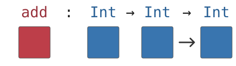
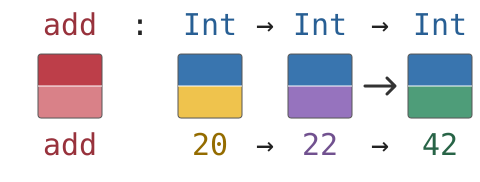
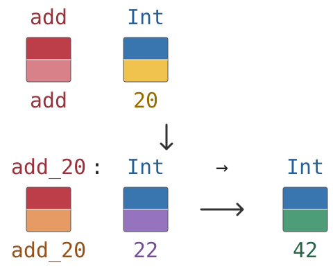

# Using more than one input

Our functions have received one value at a time. `double` received one number;
`Arithmetic.answer` received `()`. Many calculations need more information. To
add two numbers, for example, a function must receive both of them.

Ash does not require a new kind of call for this. We can use a technique called
*currying*. A function receives the first input and leaves a function ready to
receive the second.
Supplying both inputs in one line is the same process written without a pause.
We can see the two steps by starting with a complete call and then stopping
halfway through it.

## Supplying two inputs

Here is a function that adds two integers:

<!-- source: src/01-two-inputs.ash -->
```ash
add : Int -> Int -> Int
add left right = left + right

main : Unit -> Int
main () = add 20 22
```

The definition names two parameters, `left` and `right`. In the call
`add 20 22`, the inputs line up with those parameters from left to right.
Predict the value, then save and run the program. Ash reports:

```text
42 : Int
```

The substitution accounts for that result:

```text
add 20 22
20 + 22
42
```

The signature tells the same story as the definition. Function arrows
[group from the right][arrows], so we read

```text
Int -> Int -> Int
```

as

```text
Int -> (Int -> Int)
```

The first `Int` is the first input. After that input arrives, what remains has
the type `Int -> Int`: a function waiting for the second input. When the second
`Int` arrives, the calculation produces the final `Int`.

## Pausing after the first input

To make that middle step visible, remove `22` from the call. Since `main` now
produces a function, its result type must change as well:

<!-- source: src/02-one-input-left.ash -->
```ash
add : Int -> Int -> Int
add left right = left + right

main : Unit -> Int -> Int
main () = add 20
```

Before running, count the inputs still needed. `add` has received `20` for
`left`; what remains to receive `right`, and what type does it have?
Run the program to compare that prediction:

```text
<function> : Int -> Int
```

No second integer has arrived, so the result is a function of type
`Int -> Int`. The tool displays the function as `<function>`; that display
does not show its body. Such a call is often called a *partial call*, or
*partial application*: it supplies some, but not all, of a
function's inputs. The result is still useful. It remembers the input already
supplied and can receive the rest later.

The story also appears in three figures: the first aligns the signature with
its boxes, the second layers types over values in the complete call, and the
third follows the partial call from `add 20` through `add_20` to `42`.

::: {#note-add-one-input .column-margin}

::: {.block}

<!-- markdownlint-disable MD013 -->

{#fig-add-types fig-alt="The signature add : Int -> Int -> Int aligns with a red function box and three blue boxes for the integer positions." width=100%}

{#fig-add-type-value fig-alt="The same signature appears above split boxes. Upper halves show types: red for the function, blue for Int. Lower halves distinguish add, 20, 22, and result 42 by color, with labels beneath. Arrows in the lower row are schematic application guides, not conversions between integers." width=100%}

{#fig-add-20-application fig-alt="Applying add to 20 produces the function add_20 of type Int -> Int. Its separate function square has a red type half and an orange value half labelled add 20. The input 22 and result 42 have blue type halves and violet and green value halves. The value row labels the function add_20." width=100%}

<!-- markdownlint-enable MD013 -->

:::

:::

We can name the waiting function and use it in the next line:

<!-- source: src/03-reuse-a-partial-call.ash -->
```ash
add : Int -> Int -> Int
add left right = left + right

main : Unit -> Int
main () = {
    let add_20 = add 20
    add_20 22
}
```

The braces collect these lines into one *block*; its last line gives the
block's value. The binding `let add_20 = add 20` gives the waiting function
the name `add_20`. It remembers `20` and has type `Int -> Int`. The next
line supplies `22` as its remaining input. Predict the result, then run the
program and compare Ash's `42 : Int` with these steps:

```text
add_20 22
add 20 22
20 + 22
42
```

## Exercise: multiply three numbers

Start from a fresh copy of `src/01-two-inputs.ash` in your scratch directory.
Replace `add` and its uses as you build the new calculation.

Define a function with this signature:

```text
multiply_three : Int -> Int -> Int -> Int
```

Give the definition three parameters and multiply them. Then try these in
`main`, one at a time:

1. Supply all three inputs and predict the integer result.
2. Supply two inputs and predict the type of the waiting function.
3. Give the waiting function its final input and check the result.

Use the arrows in the signature to account for every input and every result.

## From inputs to decisions

A function can therefore use several inputs without packing them together.
Each call supplies one value from the left, and each arrow tells us what remains
after that value arrives. A complete call reaches the final result; a partial
call produces a function that is still waiting.

All the calculations so far have followed one fixed route. The next question
is how a program can examine a value and choose which expression should
produce its result.

[arrows]: https://github.com/dikini/ash-lang/blob/354c76b391fe4af665cf6a03479a9874a57cb3e3/spec/syntax.md#precedence-and-associativity
