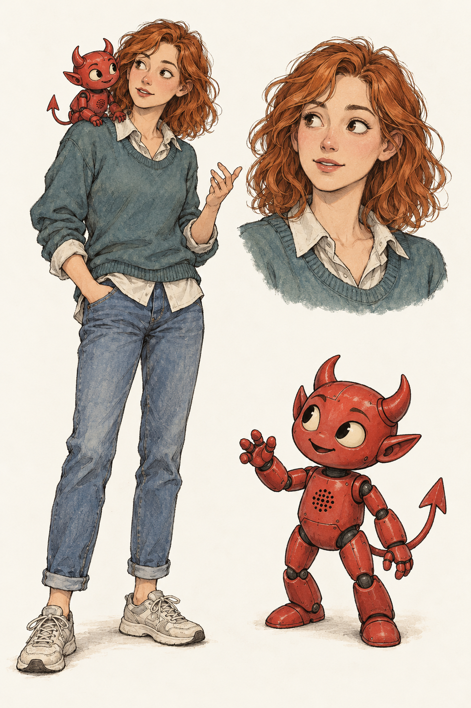

# Alice and Bot

Alice and Bot are accepted members of the recurring illustration and comic
cast. This record preserves their character brief and starting visual
reference; it does not add them to a lesson or establish Ash semantics.

## Character and background

Alice is in her twenties: geeky, curious, and interested in history,
philosophy, and K-pop. She has recently taken up computing as part of her
studies. She likes working things out and asking question after question.
She is new to computing, not new to thinking. Her questions can challenge
an explanation rather than merely invite another lecture.

Bot is her toy companion, reworked to talk back through voice communication
with a large language model. It can help her explore ideas, but is not an
infallible answer machine. Its fluent responses can themselves become
something to question and investigate.

## Appearance

Alice is slim, with shoulder-length wavy ginger hair, a small nose, and
curious, attentive eyes. She has neither glasses nor freckles. She prefers
shirts, sweaters, and jeans to dresses. Her questioning energy comes through
expression and posture, without making her look childish.

The accepted starting outfit is a collared shirt under a loosely worn
blue-green sweater, jeans, and trainers.

Bot is a small red plastic, stylised BSD-daemon-like toy with horns,
pointed ears, a pointed tail, and simple jointed limbs. Moulded seams and
a discreet torso speaker grille make its toy construction and voice
modification visible. It is mischievous and friendly, not a frightening
creature or an all-knowing oracle. The reference has no pitchfork or logo.

## Accepted starting reference

The creator accepted this sheet. It establishes Alice's identity, everyday
outfit, and companionship with Bot, alongside a separate view of the toy.
Future scenes may vary their poses and Alice's clothing while preserving
these anchors.

## Generation record

Generated with the built-in image generation tool on 25 October 2026 and
accepted in the character-development conversation. This is a raster concept
reference, not a deterministic SVG construction state.

The prompt requested a complete standing Alice with Bot perched on her
shoulder, a closer portrait of the same Alice, and a separate consistent
Bot view. It specified the appearance above, expressive slightly rough ink,
restrained muted watercolour, natural clothing textures, and warm off-white
paper. It excluded scenery, labels, panel borders, glossy rendering, glasses,
freckles, and a pitchfork. The drawing treatment was chosen to accompany
[Boyan](boyan.md).
