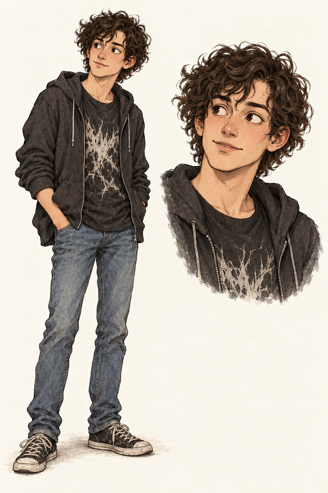

# Bob

Bob is an accepted member of the recurring illustration and comic cast.
This record preserves his character brief and starting visual reference;
it does not add him to a lesson or establish Ash semantics.

## Character and background

Bob is a computer science student in his early twenties and a friend of
[Alice](alice.md). He is into gaming, science fiction, and horror, and is
partial to metalcore. He is a bit absent-minded, but has a quick, analytical
mind and always has several things going on.

He can seem distracted before noticing a pattern or asking a sharply
relevant question. His interests can inform his references and humour
without defining every conversation. He is not merely a contrasting type
of student or a distraction for Alice to correct.

## Appearance

Bob is medium height and lanky, with dark, messy, curly medium-length hair.
He has no glasses and is clean-shaven. He wears metalcore T-shirts,
hoodies, and jeans.

The accepted starting outfit is a dark graphic T-shirt under an open
charcoal hoodie, jeans, and worn trainers. His relaxed, slightly slouched
posture contrasts with an alert, slightly amused expression. Preserve the
curls and long-limbed build without making him look childish.

The shirt artwork is abstract and original, without a named band or logo.
It suggests his taste in music without turning him into a caricature.

## Accepted starting reference

The creator accepted this sheet. It establishes his identity and typical
clothing, not a restriction to one pose or graphic. Preserve the ink and
watercolour drawing style shared with [Boyan](boyan.md), Alice, and
[Eric](eric.md).

## Generation record

Generated with the built-in image generation tool on 26 October 2026 and
accepted in the character-development conversation. Alice's and Eric's
reference sheets were supplied as drawing-style references, not faces or
outfits to copy. This is a raster concept reference, not a deterministic
SVG construction state.

The prompt requested a complete relaxed three-quarter standing view and
a larger portrait of the same Bob, preserving his curls, face, and outfit
between views. It specified the appearance above, slightly rough hand-drawn
ink, natural hatching, restrained watercolour, and warm off-white paper.
It excluded scenery, labels, panel borders, glossy rendering, glasses,
facial hair, invented band names, and logos.
