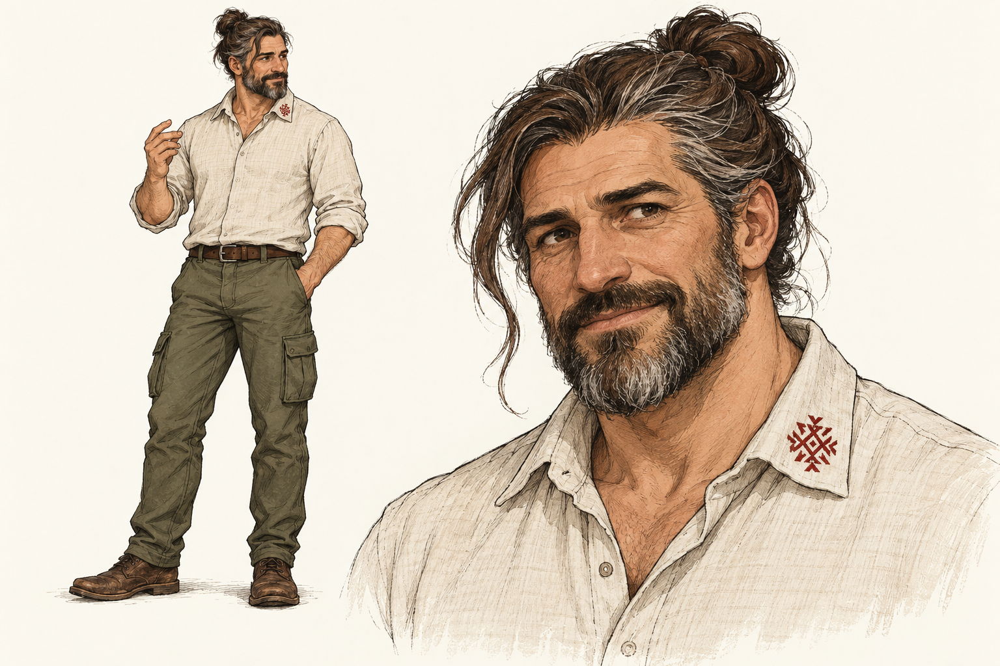
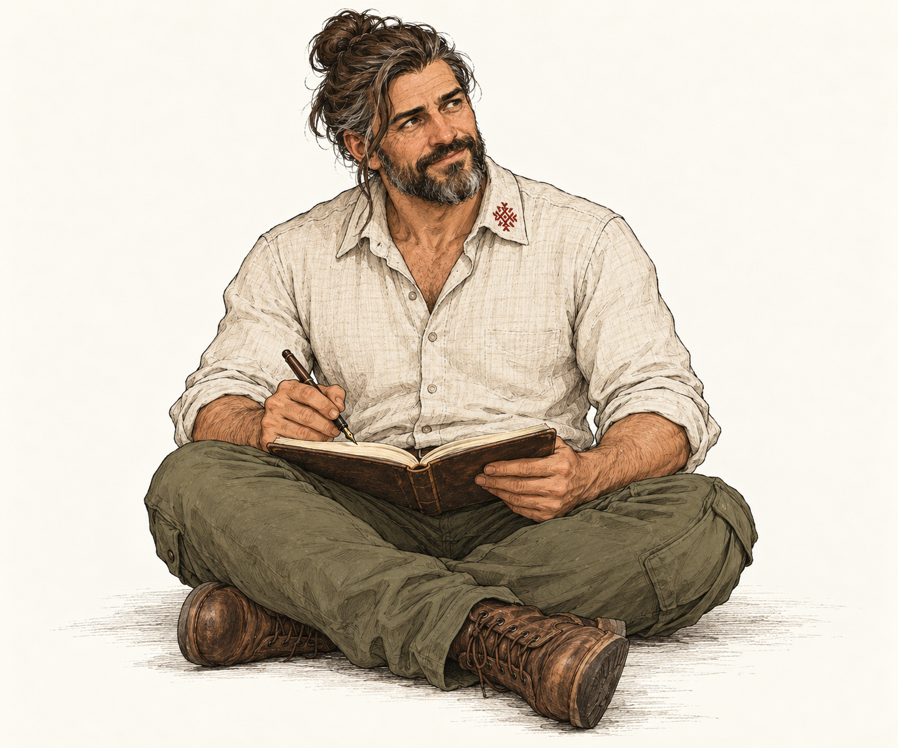

# Boyan

Boyan is the first accepted character in a proposed mixed cast of people and
creatures for occasional comic strips and illustrations. This record preserves
his fictional backstory and the two accepted starting visual references. It
does not add him to a lesson or establish Ash semantics.

## Backstory

Boyan is an immortal scholar, inspired by Neal Stephenson's Enoch Root and
the Societas Eruditorum, but a distinct character rather than a depiction of
Root. He belongs to the Societas Eruditorum. His long life gives him
perspective, not infallibility. The following is
his fictional biography, not a verified historical account; historical framing
should be checked before it becomes teaching material.

He began as a Bulgar kolobor (колобър), advising Omurtag and helping his
building and scientific programme. In Simeon's time he joined the Pliska
school, then continued to advise Peter's court through the good years.
Centuries later he was near Kaloyan. He visited the Ostroh academy, met
Paisij, and exchanged stories with him. He has travelled widely, but always
returns to the Danube.

The layers of history and experience rarely show. An Orthodox and academic
persona overlays an ancient Bulgar core that occasionally peeks through.
Travels in the East left him with the habit of forming his own hand gestures,
resembling personal mudras. They are habitual expressions of thought, not
automatic signs of magical power.

## Outlook and voice

Boyan sees modern technology through earlier transformations of knowledge.
In his telling, Simeon's Pliska and Ohrid schools were a geopolitical project
to translate Greek thought into Old Church Slavonic: a new operating system
for the Slavic world. He sees large language models as another translation
layer for human consciousness. This is his analogy, not a narrator's technical
or historical conclusion.

His older religious perspective also colours his response to AI. To him,
Tangra evokes an all-encompassing cosmic order, not a bearded figure in the
sky. The cloud and distributed neural networks feel familiar: nature finding
another medium for collective structure, silicon rather than flesh. These
are Boyan's convictions, not claims about historical Bulgar theology or
scientific accounts of consciousness.

He is untroubled by proclamations of imminent machine sentience. Having
read horses' entrails as a shaman and debated the Holy Trinity as a scholar,
he believes he knows what a soul feels like. His characteristic response is:

> It is a magnificent mirror. It has all of our memories, but none of our
> breath (Prana/Дух).

He is attentive, grounded, curious, and sometimes dryly amused. He is not
permanently solemn, a dispenser of riddles, or an always-correct teacher.
He can recognise an old pattern too quickly and miss what genuinely changed.
Other characters may disagree with him.

## Appearance

- Apparent age: forty to fifty, approximately forty-five; youthful for his age.
- Build: sturdy and physically grounded, broad-shouldered, with a substantial
  torso and strong forearms and hands. Not soft, cuddly, or a bodybuilder.
- Face: rugged, with gentle, attentive eyes. Warmth comes through attention
  and expression rather than a gentle silhouette.
- Hair and beard: salt-and-pepper dark brown, still predominantly brown;
  moderate, neatly maintained beard. Hair may be tied high or braided,
  retaining the ancient Bulgar outline described by the creator as a
  chub/chug. The starting references use a high bun and one loose lock on
  his anatomical right side.
- Movement: economical and deliberate, with small, precise personal hand
  gestures contrasting with his solid build.

He prefers high-quality natural materials: linen shirts, cargo trousers,
sometimes jeans or chinos, with or without a jacket. He always has a
traditional symbol embroidered on his clothing; the motif and garment may
change. This is a personal habit, not historical costume.

The accepted everyday outfit is an unbleached linen shirt with rolled
sleeves, olive cargo trousers, and worn-in brown leather shoes. There is
exactly one small embroidered канатица on one side of the shirt collar,
with no matching motif on the other side and no other embroidery. The
creator accepted the motif as drawn; further correction is not required.

## Accepted starting references

Both images are accepted starting references, not an exhaustive turnaround
or a restriction to these two poses. Preserve his identity across future
scenes while allowing clothing, gesture, and expression to vary.

### Standing and listening

The sheet establishes his full-body silhouette, rugged face, gentle eyes,
hair, embroidery, and everyday outfit.

### Seated and writing

He sits cross-legged, one leg slightly forward, with a notebook on his lap
and an old fountain pen in hand. He pauses mid-note to look up attentively.

## Generation record

The references were generated with the built-in image generation tool on
25 October 2026 and accepted by the creator in this conversation. The second
image used the first as its identity and style reference. They are raster
concept references, not deterministic SVG construction states.

The standing prompt requested an original character sheet with a full-body
three-quarter view and a closer portrait: hand-drawn rough ink, restrained
muted watercolour, plain warm off-white background, the appearance and outfit
above, a natural thinking gesture, no scenery, labels, magical accessories,
or panel borders.

The seated prompt preserved the same identity and style, requesting a
single complete seated figure, asymmetrical crossed legs, an open well-used
notebook supported by his lap, a vintage dark fountain pen with a visible
metal nib in his right hand, the other hand steadying the notebook, and a
quietly curious, gently amused upward glance. It excluded scenery, additional
people, text, panel borders, and magical effects.
