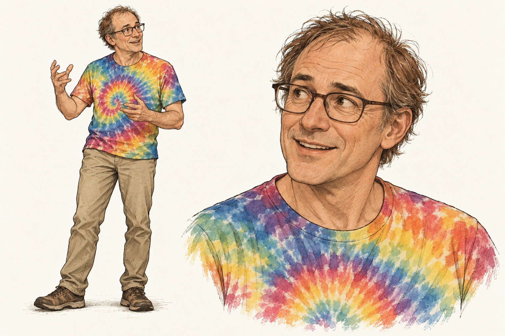

# Eric

Eric is an accepted member of the recurring illustration and comic cast.
This record preserves his character brief and starting visual reference;
it does not add him to a lesson or establish Ash semantics.

## Character and background

Eric is a computer science professor interested in type systems and
functional programming. He is immensely curious and always has several
interesting projects going. When an idea catches his interest, he becomes
enthusiastic and eager to explain it so that others can understand.

He has spent a long time applying his knowledge in industry. Theory and
practice are connected parts of his work, not competing loyalties: he can
join an elegant idea to a concrete application with enthusiasm. He is not
merely a theoretical authority brought into a scene to supply the answer.

His expressions and gestures can become animated while explaining. A useful
writing possibility is that his enthusiasm sometimes takes him several
steps ahead of a listener; understanding still requires attending to their
questions.

## Appearance

Eric is in his mid-fifties, of average build, clean-shaven, with short,
thinning light-brown hair and glasses. He likes brightly coloured tie-dye
T-shirts, chinos, and comfortable trousers. The accepted starting reference
pairs a bright tie-dye shirt with neutral chinos and comfortable shoes.

Keep his eyes visible through the glasses and his expression engaged and
approachable. His energy comes through his face, posture, and explanatory
gestures rather than an imposing build.

## Accepted starting reference

The creator accepted this sheet. It establishes his identity and everyday
outfit, not a restriction to one pose or shirt pattern. Preserve the drawing
style shared with [Boyan](boyan.md) and [Alice and Bot](alice.md).

## Generation record

Generated with the built-in image generation tool on 25 October 2026 and
accepted in the character-development conversation. Boyan's standing sheet
and Alice's sheet were supplied as drawing-style references, not as faces
or outfits to copy. This is a raster concept reference, not a deterministic
SVG construction state.

The prompt requested a complete three-quarter standing view caught
mid-explanation, with a larger portrait of the same Eric. It specified his
appearance and clothes above, natural explanatory hand gestures, slightly
rough hand-drawn ink, fine hatching, restrained watercolour, and warm
off-white paper. The tie-dye provides brighter colour within the same medium.
It excluded scenery, text, diagrams, panel borders, extra people, a beard,
and a bun.
