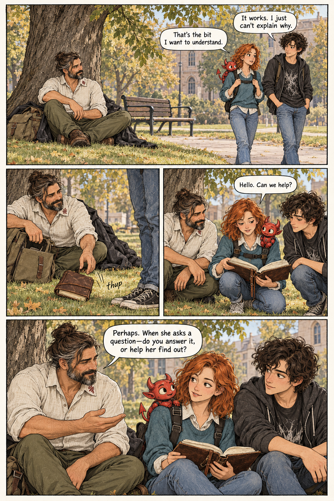
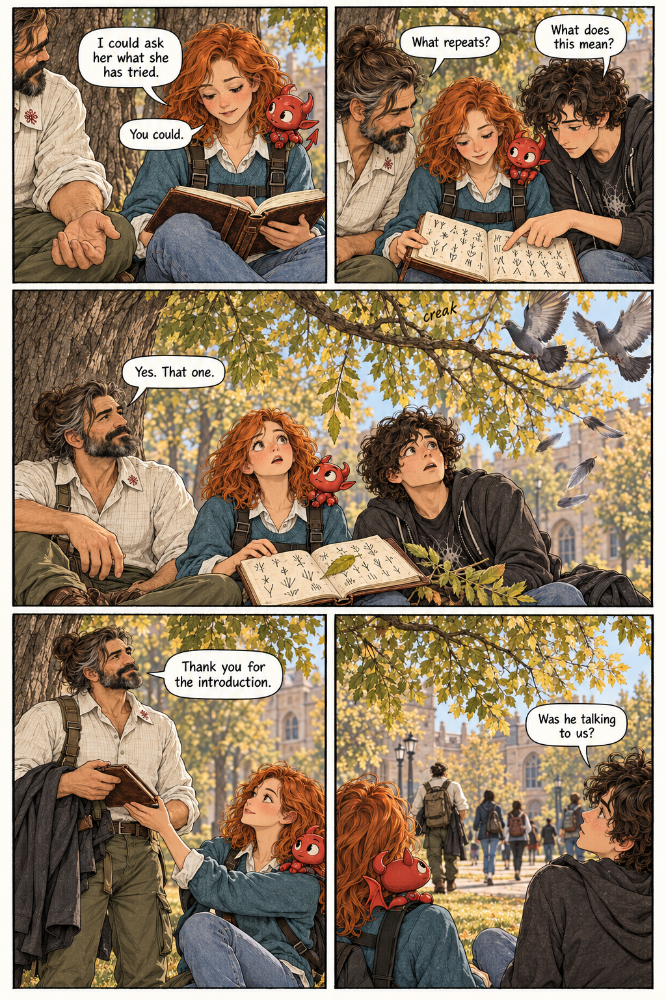

# The man under the ash

This two-page comic is an accepted first trial using the recurring cast:
[Boyan](boyan.md), [Alice and Bot](alice.md), and [Bob](bob.md). It is retained
as project artwork, not inserted into a lesson or presented as Ash semantics.

## Intent and continuity

The creator supplied a scene in which a wanderer beneath an ash tree draws
Alice, Bob, and Bot into a philosophical encounter. The wanderer is Boyan;
his established appearance replaces the older man in the original scene
description. Prose impressions and emotions guide the acting and atmosphere,
not narration boxes. The simplified script below was approved before drawing.

Boyan interrupts their walk by apparently dropping his notebook. He invites
Bot to help Alice investigate rather than immediately supply an answer.
A falling leaf and startled pigeons suggest that the tree participates,
without explaining whether the coordination is supernatural or coincidental.
There is no facial-recognition readout or claim about Bot's internal state.

The comic preserves the cast's ink-and-watercolour treatment. Boyan has an
additional charcoal coat and canvas pack; Bot rides in Alice's harness.

## Retained pages

### Page one: an interruption

### Page two: the host

The creator approved retaining this trial after viewing both pages. Two
lettering issues remain: page two places Boyan's “What repeats?” before
Bob's question in normal reading order, and Bot's speech-balloon tails need
clearer attribution. These are retained draft limitations, not corrected
artwork. A future lettering pass should preserve the accepted character
designs and scene while fixing those issues.

## Approved script

### Page one

1. Boyan sits beneath the ash, coat spread on the grass. The nearby bench
   is empty. Alice and Bob approach with Bot on her harness.
   Bob: “It works. I just can't explain why.”
   Alice: “That's the bit I want to understand.”
2. Boyan reaches into his pack. A heavy notebook slips onto the grass in
   their path. Sound: “thup”.
3. Alice retrieves it. Bob notices the handwritten pages. Boyan looks
   directly at Bot. Bot: “Hello. Can we help?”
4. Boyan, quietly amused: “Perhaps. When she asks a question—do you answer
   it, or help her find out?” Alice glances towards Bot.

### Page two

1. A quiet beat. Bot: “I could ask her what she has tried.”
   Alice: “You could.” Boyan's free hand rests in a loose personal gesture.
2. Bob studies the notebook: “What does this mean?”
   Boyan: “What repeats?”
3. An ash leaf settles precisely on a repeated mark. A branch creaks and
   pigeons burst upwards. Alice and Bob startle. Boyan looks up:
   “Yes. That one.”
4. Boyan rises, receives the notebook, and nods towards the tree:
   “Thank you for the introduction.”
5. Boyan disappears into the campus crowd. Alice and Bob look back at
   the ash. Bob: “Was he talking to us?” Bot tilts towards the canopy.
   No answer.

## Generation record

Both pages were generated with the built-in image generation tool on
26 October 2026. The accepted Boyan, Alice/Bot, and Bob reference sheets
were supplied for page one; page one supplied continuity for page two.
The PNGs are retained without conversion or resampling. They are raster
comic trials, not deterministic SVG construction states.

The prompts specified four panels on page one and five on page two,
the approved dialogue, precise character identities and wardrobe, a
contemporary university park beneath an ash with compound foliage, muted
autumn daylight, rough ink and fine hatching with restrained watercolour
on ivory paper. They requested readable speech balloons and excluded
narration boxes, titles, page numbers, technological readouts, magical
beams, and explanatory captions. The generated lettering limitations
above remain visible despite those instructions.
