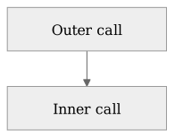

# Notes

A numbered reference attaches secondary detail to this sentence.[^detail]

## An example using earlier notation

This paragraph supplies the local context for a brief reminder. The reminder
is supplementary; the explanation continues in ordinary chapter order. Some
extra prose separates this reminder from the numbered note above so that both
can remain readable at their own locations.

::: {#reading-cue .column-margin}
*Reading cue.* Read the premises before the conclusion.
:::

The example follows an idea introduced earlier. Its explanation remains in
the main text, and the reader can follow it without tracking a note number.

The next paragraph continues the same example. It leaves the note's local
association clear when an e-reader returns the material to one column.

<!-- markdownlint-disable MD013 -->

[^detail]: A numbered secondary clarification.

    {fig-alt="Two labelled boxes, outer call and inner call, connected vertically as a schematic reading aid." width="100%"}

<!-- markdownlint-enable MD013 -->
