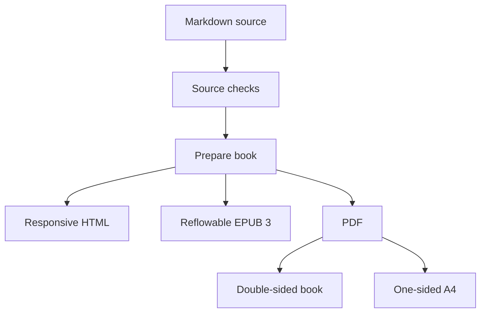
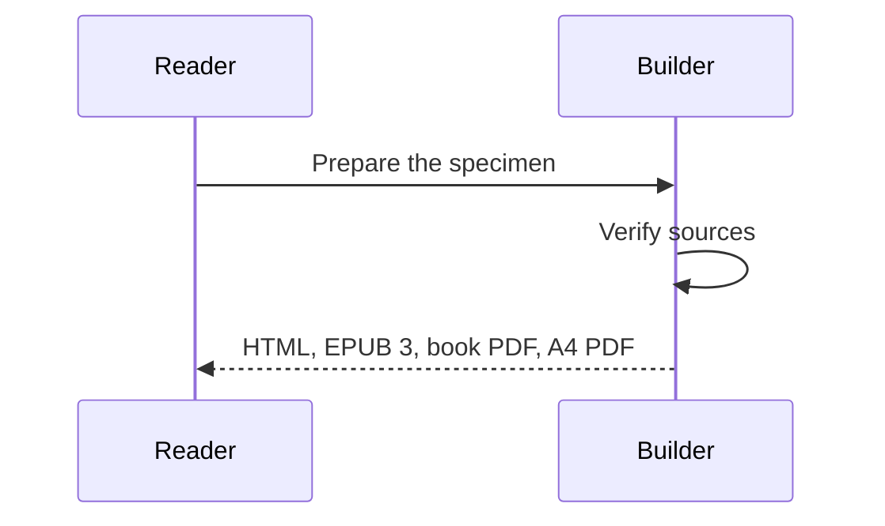

---
diagrams:
  - kind: mermaid
    id: fig-rendering-path
    caption: One source passes through checks before four layouts.
    description: Markdown is checked, then rendered as HTML, EPUB, book PDF, and A4 PDF.
  - kind: mermaid
    id: fig-interaction
    caption: A reader asks a build tool to prepare a book.
    description: The reader requests a build, the builder verifies sources and returns four artifacts.
  - kind: ebnf
    id: fig-grammar
    caption: A name is followed by zero or more comma-separated names.
    description: A list contains one name and a repeated comma and name; a name is either alpha or beta.
  - kind: sequent
    id: fig-inference
    caption: Two premises support one conclusion.
    description: From P and P implies Q, modus ponens derives Q; a nested fixture derives R.
  - kind: split
    id: fig-split-application
    caption: Types sit above the values they describe.
    description: The signature aligns over split squares; lower halves name the values, and the arrow marks the application guide.
  - kind: split
    id: fig-split-repair
    caption: A candidate tree repairs to a reconstructed tree.
    description: The before phase nests red nodes below a black node; the after phase rewires the same associations and subtrees.
---

# Notes and notation

This chapter is a rendering fixture. Its figures exercise layout and notation;
they make no claims about Ash behavior. The existing lessons in this specimen
provide the program and diagnostic material.

## Notes near their references

A note should remain associated with the sentence that introduces it.[^short]
The browser and printed book can place it in a margin. An e-reader needs a
linked note that remains reachable as its font size and line lengths change.
A one-sided A4 copy keeps both short and long notes in its right margin.

[^short]: This short note tests the relationship between a reference and its
    associated explanation.

A longer note tests available space and the placement of nearby notes.[^long]
Neither note supplies an answer to an exercise in the existing chapters.

[^long]: This longer note contains several sentences so that a rendered page
    must allocate real space to it. The note is secondary material. Its text
    should stay readable when a narrow browser moves it out of the outer margin,
    when an EPUB reader enlarges the font, and when a PDF page contains another
    note nearby. The main paragraph should remain available in reading order.

## Output formats and print variants

The graph has one source and four outputs. Its labels should remain legible
at narrow widths and in a grayscale print.



## Interaction sequences

This sequence describes a build request and response. It is an interaction
sequence, separate from the inference-rule notation below.



## Railroad grammar

The grammar fixture combines alternatives, a reference to another production,
and repetition. The railroad renderer should retain those relationships in
its derived figure.

```ebnf
list ::= name { "," name } ;
name ::= "alpha" | "beta" ;
```

## Sequent inference rules

Each rule has premises above a bar and one conclusion below it. Formula
spelling and nested derivations belong to this specialised notation renderer.
The fixture uses propositional letters rather than Ash terms.

```sequent
family examples:
  Modus-Ponens :=
    P
    P -> Q
    ===>
    Q
  Nested :=
    [ P
      P -> Q
      ===>
      Q ]
    Q -> R
    ===>
    R
```

## Split-shape figures

Split squares and split circles carry two layers in one shape: the upper
half names a category, the lower half names the instance. The fence source
replaces hand-drawn SVG; the renderer derives every coordinate.

```split
sig: [add] : [Int] -> [Int] -> [Int]
row: fn/add int/20 int/22 int/42
arrows: 3->4
```

A tree figure stacks before and after phases with an implicit transformation
arrow. Subtree names render as markers on a shared baseline.

```split
tree:
  black/(k1,v1)
    red/(k2,v2)
      red/(k3,v3)
        a
        b
      c
    d

tree:
  red/(k2,v2)
    black/(k3,v3)
      a
      b
    black/(k1,v1)
      c
      d
```

## A compact comparison

| Output | Reading behavior | Notes | Diagrams |
| --- | --- | --- | --- |
| HTML | Responsive chapters | Margin or linked | Static SVG |
| EPUB 3 | Reader-controlled reflow | Linked | Static SVG |
| Book PDF | Mirrored book pages | Outer margin | Vector figures |
| A4 PDF | One-sided pages | Right sidenotes | Vector figures |



## A full-width aside

A wider explanation can use the text column and its adjoining note space.

::: {#full-width-note .column-page-right}
*Full-width note.* The text and note columns can share a single aside when an
explanation needs more room. This paragraph keeps the same reading order while
using the space normally reserved for sidenotes. A narrow screen or e-reader
returns the block to one flowing column.

| Body text | Sidenote text | A shared aside |
| --- | --- | --- |
| Regular type | *Secondary explanation* | **A wider reading area** |
| `inline_code` | Short or long notes | One reading order |

:::

The [first program](../../content/learn/what-is-an-ash-program/README.md) tests
an internal chapter link. The [writing workflow](../../docs/project/workflow.md)
tests a link to source material outside this specimen.
